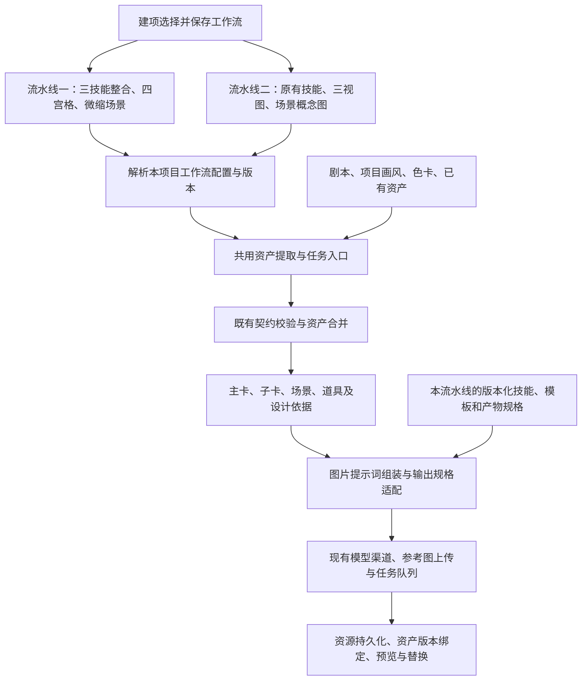

# 短剧双流水线与三技能全量整合需求说明

状态：已批准实施。双流水线、技能包及图片产物适配已进入回归；发布和真实模型验收结果单独记录，不以本文的目标描述代替验收证据。

## 1. 需求复述

在新建项目第 4 部分“怎么做”中，位于“每段时长”下方、“视频模型”上方的红框位置，增加“工作流”单选项，提供“流水线一”和“流水线二”。本次三技能整合的新流程命名为“流水线一”，作为新项目默认选择；当前已有流程命名为“流水线二”，继续保留。

流水线一首次发布即完整包含三技能整合后的资产提取、人物主卡与子卡四宫格、微缩场景图、道具图片，以及空间母版到九宫格和选格重绘的必要支持。不再采用先上线旧三视图、以后补齐四宫格与微缩图的两期方案。九宫格和重绘在对应分镜阶段按实际操作执行，不在建项时无条件额外生成所有图片。

三技能的分工为：以“小墨个人资产提取”负责从剧本提取人物、道具和场景，以“character-asset-prompts”负责人物设计与四宫格绘图提示词，以“chinese-scene-diorama-storyboard”提供空间母版、多机位与一致性方法。流水线一的微缩场景图覆盖不同题材的实际空间，中式古建细则只用于相应场景。

整合应适用于不同题材、时代和视觉媒介；三份技能协作使用同一套资产事实、身份和引用，不各自重复提取、重复建卡。必须区分稳定的流程框架与可独立升级的技能内容，优先通过技能包、提示词模板和既有数据字段实现。确实涉及输出规格或执行能力的缺口，单独列出最小适配，不借此重写整个工作流。

本轮按用户批准完整开发、回归、发布，并使用随行鲜剧本验收两条流水线的文本与图片。“全量上”不代表忽略用户选择的生成模式或提前调用视频模型；本轮不调用真实视频模型，也不自动重试历史失败任务。现有声音流程、视频时长适配、同场景连续生成与白模开关继续保持各自职责。

## 2. 三份材料的定位与整合取舍

| 材料 | 采用的核心能力 | 接入时需要处理的差异 |
| --- | --- | --- |
| 小墨个人资产提取，`character-analyzer` v1.3.0 | 原文事实与推导分级；人物六要素；人、物、场分离；道具设计卡；场景空间分析；交叉索引与状态时间线 | 原始交付是三份 Markdown 文档，生产传输需映射到既有 JSON Lines；不能把每个可移动名词都转成独立排图任务 |
| `character-asset-prompts`，入口未声明版本 | 人物辨识锚点、锁定卡、服装轮廓与材质、跨媒介适配、主卡与变体一致性、局部修改、提示词检查 | 流水线一完整承接竖版四宫格；流水线二保持既有三视图。中文设计说明与现有英文摘要分别映射，真实出图服从产品中的提交与生成模式 |
| `chinese-scene-diorama-storyboard` v1.1.0 | 完整空间母版、坐标与固定地标、多机位复用、中央母版加八格实景、选格高清重绘 | 将通用空间方法适配到现代、古代、室内、半室外和外景；保留古建专项规则的适用范围；真实母版引用与产物依赖首次发布一并完成 |

采用“一个资产设计入口、三类专业能力模块”的结构。整合分析方法与约束，不把三份原文首尾拼接，也不在每个角色后重复运行三次模型。

## 3. 当前实现及实际限制

以下结论依据仓库基线 `029a5c7212545e5ce065c34f216ebd87b49abd36` 的代码，不代表已重新检查线上技能库的激活版本。

| 现有能力 | 已核实的实现 | 对本方案的影响 |
| --- | --- | --- |
| 资产提取入口 | `assets.extract`，契约 `assets.extract@1`；按现有场次轮次输出 JSON Lines | 继续使用，不另建三套提取入口 |
| 内置技能包 | `yz-assets-extract` v1.3.2，已经增量纳入小墨 v1.3.0 的方法 | 以现包为来源增量整合；两条流水线分别绑定版本，不能通过全局替换把流水线二一起改成新流程 |
| 技能加载 | 入口加最多三份被点名的相关文本卡；该步骤总预算为 32,000 个 JS 字符串长度单位 | 必须实际声明、装包并验证卡片加载；不会自动遍历第三方目录或执行其中脚本 |
| 资产结构 | 人物、场景、道具；角色 variants；设计内容写入 `extractionDesign`，含证据、关系与状态 | 复用资产主体；为工作流归属、完整提示词与新图片规格补齐必要的版本化元数据 |
| 长度处理 | `appearance` 入库压缩后截至 600，`prompt_en` 截至 1,200，按现有 JS 字符串口径 | 不能直接塞入第三方长提示词；完整设计与出图摘要分开，验收不能把截断后的结果算作完整输出 |
| 角色出图 | 当前启用的 `character_turnaround` 模板规定三等分、正侧背全身；设定包含 `multiViewPrompt` | 流水线一必须适配四宫格最终模板；流水线二保留三视图，不能互相覆盖 |
| 角色图片绑定 | 整张图绑定为 `turnaround_sheet` 与 `primary`，当前收尾代码没有自动切出四个角色视图 | 四宫格整图与独立头像等子产物必须区分，不能声称已有自动切图能力 |
| 场景、道具出图 | 使用已保存的描述、提示词、项目画风和实际参考图组装任务 | 新技能必须影响实际提交提示词，不能只增加资产页说明 |
| 既有参考依赖 | 子卡等待主卡图片并携带主卡参考；其他资产已有色卡引用 | 复用现有能力，并在本次完整交付中补齐关键道具到场景、母版到九宫格及重绘所需的实际依赖 |
| 项目流程选择 | 当前建项“怎么做”包含画幅、时长、模型与生成模式，尚无本需求中的双流水线选项 | 新增项目级工作流标识及解析配置，贯穿建项、读回、任务与续跑 |
| 道具优先级 | 已有 `production_priority` 与低优先级默认不排图 | 继续使用，不用增加另一套预算与排队规则 |

资产提取完成后，现有服务会建立已确认资产，并可按当前设置继续排图，并非所有资产都会经过一次手工审批。本方案不凭空增加逐资产确认关卡。

## 4. 通用设计与解耦边界

### 4.1 目标处理链



两条流水线共享执行框架，通过配置分别选择技能、契约与图片规格，不复制两套业务服务或队列。此图描述职责和依赖，实际运行状态以任务和产物记录为准。

### 4.2 三层职责

| 层次 | 负责事项 | 不承担的事项 |
| --- | --- | --- |
| 流程框架 | 项目归属和权限、工作流标识与版本、资产 ID、版本、契约校验、任务状态、并发、取消、失败续跑、真实引用解析、资源保存、模型参数、额度与费用 | 不硬编码宋代家具、人物脸型、服装材质、镜头审美或某个技能名称的专属分支 |
| 技能与模板内容 | 事实提取、推导与设计建议、人物辨识与服化道、道具制作价值、空间设计、适用条件、画面描述、自检规则 | 不自行上传图片、创建任务、授予调用权限、改变预算或通过文字绕过失败状态 |
| 薄适配与配置 | 按项目工作流解析技能、契约、模板和产物规格；映射结果字段，拼装完整提示词，校验实际参考图与长度 | 不新建第二套任务引擎，不在前后端复制三套技能业务逻辑 |

业务方法优先放进技能；不可依靠模型保证的权限、数据一致性、真实参考绑定和提交限制必须留在代码。解耦不等于把所有判断都交给提示词。

### 4.3 优先级与冲突处理

1. 系统权限、真实模型能力和受保护的数据契约始终有效，技能不可覆盖。
2. 用户明确要求及其确认的项目设定优先于技能默认值。若有意改编原文，应记录为改编设定，不能伪称原文事实。
3. 原文事实、既有确认身份与时间线共同约束新增设计；发现矛盾时明确标出，不静默覆盖用户已确认资产。
4. 项目锁定的媒介、画风、色卡和美术规范优先于第三方的默认摄影机、胶片、低饱和或写实偏好。
5. 专项技能只在其适用条件成立时使用；不足的信息区分“未明确”“推导”“设计建议”，不把默认值写成事实。

## 5. 功能需求

以下新增提取方法、人物四宫格和场景空间规则面向流水线一；流水线二按其原有技能、契约与模板运行。项目归属、权限、任务快照、资源绑定等通用保障适用于两条流水线。

### FR-00 建项工作流选择与默认行为

在“怎么做”中按以下顺序排列：画幅 → 每段时长 → **工作流** → 视频模型 → 生成模式 → 现有辅助选项。

| 选项 | 简要说明 | 默认行为 |
| --- | --- | --- |
| 流水线一 | 新版资产工作流：三技能整合提取、角色四宫格、微缩场景图 | 新项目默认选中，显示“默认”标识 |
| 流水线二 | 原版资产工作流：现有提取、角色三视图、场景概念图 | 用户可以主动选择，保留现有行为 |

- 使用与建项页一致的单选控件或选择卡，明确选中状态，支持鼠标、键盘和窄屏布局；不能同时选中两条流水线。
- 全新建项表单默认流水线一，不因最近使用过流水线二而改变该默认。恢复未完成的建项草稿时保留草稿的明确选择。
- 在提交前允许切换；切换只改变工作流选择，不清空正文，不重置画风、模型、画幅、时长和生成模式。
- 选择工作流本身不发起模型任务。提交制作后，按所选生成模式执行；“跑到出视频前”仍在视频调用前停止，“资产我要过目”“每步都问我”沿用原有停点。
- 工作流与文生/图片/视频模型选择独立，与 15/30 秒档位和白模分镜开关独立；选择流水线一不等于开启片末白模衔接。
- 项目保存并读回明确的工作流 ID，界面名称不作为路由条件。新建参数缺省时由前后端共同按流水线一处理；非法值由后端拒绝，不静默改选。
- 历史项目在上线迁移时明确标记为流水线二，继续原有流程；不能因为新默认值而将旧项目改走新技能或重画已有资产。
- 项目详情可查看已选工作流。本次只提供建项时选择，不增加已有项目运行中跨流水线切换及资产迁移功能。

### FR-01 统一资产提取与事实底稿

- 延续现有按场输出与全篇上下文，识别同一人、同一道具和同一空间，不让三份技能分别重新命名实体。
- 保存原文位置、依据、设计建议、关联实体和状态变化；分析底稿要完整，出图摘要要可执行，两者分开。
- 同一角色跨年龄、职业服装与临时状态采用主卡和子卡，不新建互不关联的人物。
- 同一地点的日夜、天气和使用状态原则上保持空间身份；变化记录到现有状态描述。镜头中真实切换到另一地点时不得强行合并。
- 保留已经修复的歧义别名防合并、同场中途换装边界与后文状态不得倒灌初始外观等规则。

### FR-02 人物设计与主卡、子卡一致性

- 六要素描述继续作为人物提取基础，再吸收角色技能的 3～5 个可见辨识锚点与可执行服装设计方法。数量是设计目标，信息不足不编造凑数。
- 身份稳定特征与年龄、发型阶段、服装和临时状态分开管理。跨年龄允许合理变化，不要求五年前与现时的发型、体型、职业着装完全相同。
- 主卡与子卡共享可识别身份；子卡只写变化范围，并继续使用系统实际绑定的主卡图片作为参考。
- 服装写清轮廓、剪裁、主要材质及可见的垂坠或反光表现；不为了“有设计感”统一添加伤疤、脏污、夸张配色或成人皱纹。
- 人物资产图不手持与身份无关的独立道具；不把道具完整设计重复烘焙进人物卡。
- 默认利用已有剧本、风格与用户输入，不在自动流程中为每个人物额外开启一轮固定问卷。必要信息缺失时沿用产品现有编辑、确认方式。
- 重新提取与生图不得自动覆盖用户手工上传的主卡或子卡图片，也不得丢失已经确认的局部修改。

### FR-03 人物图片输出规格

按所选流水线采用对应规格，首次发布同时提供，不分期交付。

| 规格 | 定义 | 使用范围 |
| --- | --- | --- |
| 四宫格 | 上左正面头像；上右严格 90° 侧脸；下左从颈部以下至鞋底的正面身体；下右含头部至鞋底的背面全身 | 流水线一的主卡与子卡默认输出，不再另行开启增强开关 |
| 现有三视图 | 正面全身、侧面全身、背面全身，身份、服装及比例一致 | 流水线二继续使用，保留其原有模板与绑定方式 |

四宫格采用来源技能的竖版 2:3、两列等宽、上排约 38% 与下排约 62% 为默认配置，可按用户要求调整；四区保持同一人物、同一阶段、同一服装，分隔线简洁，不生成标号、说明文字或水印。人物左右与画面左右必须明确；正面身体裁掉头部不等于无头人偶，背面身体不能漏头。禁止用全局“不要头部”“不要重复人物”等约束破坏指定版式。

角色资产图片画幅与项目视频画幅分别处理，并受真实图片模型支持的比例限制。流水线一须完成整张四宫格的保存、绑定、缩略图、放大预览、上传替换与重新生成，并记录版式和四个区域的语义。按实际消费需求输出区域裁图时，必须区分“头像”“侧脸”“颈部以下正面身体”“含头背面全身”，不冒充旧三视图；默认一次生成一张四宫格，不自动增加四次独立生图。

资产页、子卡编辑、补图/继续出图、手动重新生成和自动流水线必须使用同一工作流规格。流水线一界面显示“四宫格”，不能显示“生成三视图”但实际提交四宫格，或反过来。

### FR-04 道具分析完整、建卡克制、排图分级

建立三个不同概念：**分析中记录了该物件、需要独立资产身份、需要立即生成图片**。三者不能等同。

- 分析层不漏掉剧情动作、特写、信物、产品结构及连续性线索。
- 核心、反复出场、独立操作、特写或需要跨镜复用的物件，建立独立道具资产；按现有 high / medium / low 标记制作优先级。
- 普通背景陈设不因“能移动”就必然独立建卡。其空间位置与必要外观可保留在场景分析中；已经有独立制作价值的低优先级道具仍建卡，但默认不排图。
- 同类普通消耗品按合理集合管理；不为每一个橙子、每一张同类纸币分别建一张资产卡。剧情中需辨认的特定纸币或贴纸等线索另行保留其归属与状态。
- 日常围裙、眼镜、帽子等一般归服装；当其被作为独立信物、交换物或动作对象时，再判断是否需要独立道具身份。
- 道具主图只设计本体及固定部件。人物、其他可移动物、容器内容物与摆放关系写入关联设计，避免一辆推车的资产图包含整套果汁摊。
- 后续阶段的换轮、胶印、磨亮或损坏不得无条件提前画进首次出场版本。

流水线一所用受保护契约中“可移动物件独立建道具”等过宽文字应同步澄清为上述规则。只改技能、保留相反的契约文字，不算完成接入。本项优先复用现有 JSON 形状，但契约规则也必须按工作流版本隔离，不能原地覆盖流水线二使用的原契约。

### FR-05 通用场景分析与专项空间母版

通用场景能力适用于所有题材：记录室内、室外或半室外，空间边界、主要通道、固定结构、光源、可站立锚点、关键道具位置、遮挡与纵深。中文描述按空间顺序写清，不用抽象氛围词替代空间事实。

流水线一在场景资产生图时默认生成对应空间的微缩场景母版，不需要额外开启专项功能。将 `chinese-scene-diorama-storyboard` 的空间布局、固定地标与多机位一致性方法通用化，同时按空间类型选择规则：

| 空间类型 | 微缩场景图要求 |
| --- | --- |
| 中国传统围合室内 | 使用古建专项规则，保留实际四墙、门窗与时代形制 |
| 现代及其他围合室内 | 沿用完整空间布局表达，建筑、家具和材质符合原文，不套宋式陈设 |
| 半室外空间 | 保留真实顶棚、支撑与敞开边界；如便民市场，不凭空补成四墙房间 |
| 外景、街巷、自然空间 | 用微缩空间总览表达地形、道路、建筑及区域关系，界定取景范围，不加虚构围墙或屋顶 |
| 二维、三维、定格等媒介 | 微缩是空间表达方式，画面仍遵循项目媒介，不强制改成写实模型或三维渲染 |

流水线二继续生成原有场景概念图。两条流水线均保留原文与项目设定优先的原则。

完整围合微缩母版的要求：

- 高斜俯视而非垂直顶视，屋顶移出视线，保留实际存在的四面墙及真实遮挡；不是拆掉墙面的剖切娃娃屋。
- 建立场景局部方向约定，固定门窗、通道、主要结构与道具的相对位置；局部“北、南”不自动当作剧本的地理事实。
- 固定可辨认地标，数量以原文和合理设计为准，不为凑足五个添加不存在的设施。
- 按项目媒介表现材质、色彩和光线，不强制加入“禁止 CGI / 3D”之类与项目冲突的负面词。
- 母版不出现人物，主要交代空间结构；用于后续分镜时，不要把微缩底座、棚拍背景或模型观感带入实景镜头。
- 专项母版默认 1:1，九宫格与实景单格默认 16:9；用户要求与真实渠道能力优先，不能为了凑比例裁掉必要结构。

微缩图归属对应的场景资产，作为流水线一的空间母版与可见封面；同时记录其“空间结构参考”用途，不能冒充真实尺度的实景画面。下游使用时明确保留项目画风与真实尺度，不把微缩底座、模型尺寸或俯视机位当成分镜的画面要求。

不为了保留旧流程而默认再生成一张重复的普通场景概念图；确需实景视图时在对应分镜阶段按需求派生。微缩图生成失败时展示原因并提供既有恢复入口；依赖它的九宫格或重绘等待恢复，但不把微缩图缺失升级成普通分镜或视频提交的新增强制闸门。

### FR-06 中央母版与八格实景的九宫格

- 九宫格按 01～09 的逻辑顺序管理；数字用于说明与定位，不渲染成画内文字。
- 中央 05 格完整展示同一张空间母版，是核对空间的锚点，不作为第九个剧情镜头或默认视频首帧。
- 其余八格是该空间内真实尺度的电影机位，明确位置、朝向、高度、景别、可见结构与遮挡；反打由机位变化形成，不能水平镜像重造空间。
- 中央母版与单格比例不同时完整缩放并适度留边，不能裁掉墙体或拉伸结构。
- 选格进入正式分镜时可高清重绘，但必须使用实际母版和所选格作为输入，不能把低清裁图简单放大后宣称完成重绘。
- 九宫格及选格重绘能力属于流水线一首次完整交付范围，在分镜制作的对应操作中使用实际母版；不因“后续增强”而延期或以占位按钮交付。
- 九宫格是空间规划产物，不替代已有按剧情拆出的镜头组、时长与动作编排，也不自动把八格全部转成八个视频任务。能力全量交付不等于每个场景必须无条件生成九宫格及八张重绘图。

### FR-07 真实参考、产物依赖与白模隔离

- 人物主卡、子卡、道具母图、场景母版和九宫格分别拥有明确来源；生成结果仍归属原资产，通过既有资源与版本机制管理。
- 需要复用的关键道具在场景图中出现时，不能只写“参考某道具名称”就算图片一致性已验证。必须检查实际图片输入、结构描述与生成结果。
- 文案中的 `@图片1` 等标识只能由实际渠道输入映射产生。模型尚未收到图片时，不生成虚假的引用标识。
- 母版生成成功并保存后，才允许以该产物为九宫格的实际参考；选格重绘同理。参考不可用或数量超过能力时说明缺口，不静默丢弃关键身份或空间参考。
- 当前队列未具备的依赖能力，不得由技能文字代替。首次发布补齐所需串联，复用既有任务和参考上传逻辑，只增加缺失的通用产物依赖适配，不另建场景专用任务引擎。
- 场景设计母版与同场景连续生成的片末白模截帧是两类产物：前者用于设计空间，后者记录前镜结束时的人物站位。各自保留用途与来源，不互相替换；本次不改变白模开关或视频衔接规则。

### FR-08 语言、长度与最终提示词

- 面向用户的设计说明优先中文；现有 `prompt_en` 继续保存英文出图提示词，不能在字段名不变时悄悄改成中文全文。
- 三份独立设计报告的内容拆入现有 `extractionDesign` 各字段；主卡 `appearance`、角色 `multiViewPrompt`、场景/道具 `description` 与 `prompt` 只承载相应摘要和出图内容。
- 现有 600 / 1,200 字段可以继续存放兼容其语义的摘要；流水线一的完整四宫格、空间母版及九宫格提示词必须有明确、可持久化的承载，不能经过旧摘要字段静默截断。所需字段、解析和模板映射纳入本次完整交付。
- 来源角色技能的 4,000 Unicode 字符上限是其自身交付规则，不是所有渠道的能力，也不能覆盖现有字段长度。正式提交时还要检查模板、画风、参考说明拼接后的完整提示词。
- 不自动执行附件中的 Python 计数脚本；计数检查应通过项目既有测试或必要的通用校验实现，且区分 Unicode 字符、JS 字符串长度与模型 token。
- 现有截断破坏必要设计属于发布阻断缺陷。采用受校验的版本化提示词承载及完整请求长度检查，不以删掉四宫格区域或空间几何约束适应旧上限，也不盲目提高全系统其他字段上限。
- 验收同时检查提取文本、持久化资产、最终模型请求，三者语义一致；不能仅凭资产页展示正确判定通过。

### FR-09 调用授权、版本与恢复

- 来源技能的“默认只交付提示词”与产品出图权限分别处理：仅提取时不出图；用户在现有流程选择并授权出图后，沿用原排队方式执行，不重复询问同一授权。
- 流水线一在说明和生成清单中明确人物四宫格、微缩场景母版等默认产物及估算数量；九宫格、重绘按对应阶段的实际操作列入范围，不隐式展开所有角度。沿用现有额度、报价与停点，不为每张默认产物重复索取已给出的生成授权。
- 原有取消、失败续跑、防重复建卡与图片绑定机制继续生效；本次不触发历史失败任务自动重试。
- 技能包按既有版本、评测、绑定与激活机制发布。仅部署代码或更新内置种子，不等于线上已切到新版本。
- 保留旧版本与回切路径；新规则先用于新项目验收。已有项目重新提取时继续保护已确认身份、图片及人工修改，不批量重算历史资产。

### FR-10 项目级工作流路由与运行快照

- 建议使用稳定标识 `pipeline-1` / `pipeline-2`，前端展示“流水线一”/“流水线二”；工作流显示名称与技能文件名均不作为执行分支的判断依据。
- 项目保存工作流 ID 和配置版本，创建接口、详情接口、草稿恢复和必要数据库迁移同步更新；相关数据库与 API 文档随开发补齐。
- 工作流配置统一描述步骤、技能版本、契约、模板、人物图片版式、场景产物规格与依赖。通用执行器按配置运行，避免在每个页面和生成函数里分别维护一套条件分支。
- 现有“风格档案＋步骤”的技能解析须增加工作流配置这一维度，或等价地先解析项目清单再进入既有绑定；不能靠修改全平台当前激活技能区分两条流水线。
- 流水线二保留既有行为基线；流水线一继承其中已经修复的通用问题。新模板、新版式和新技能的发布不能污染流水线二。
- 每个任务记录工作流 ID、配置版本及实际使用的技能/模板版本、资产版本和参考资源。刷新、取消后续跑、失败步骤重试与后台继续执行，都使用该任务的有效快照，不在过程中改走另一条流水线。
- 失败重试复用仍有效的主卡、微缩母版、上传资源与已完成步骤，避免重复调用和重复绑定；不自动重试历史失败任务。
- 无正文空项目只保存选择，不触发模型流水线；已有正文和人工资产不得因工作流默认值变化被覆盖。

## 6. 数据映射与包结构

### 6.1 优先沿用的字段

| 技能语义 | 现有承载 | 约束 |
| --- | --- | --- |
| 项目工作流 | 当前尚无本需求对应的双流水线字段 | 增加项目级工作流 ID、配置版本和任务快照，历史项目明确归流水线二 |
| 稳定身份与别名 | `category / name / aliases` 与服务端资产 ID | 不由第三方技能编造生产 ID，不用泛称跨实体合并 |
| 角色六要素与绘图摘要 | `appearance / prompt_en` → `appearance / multiViewPrompt` | 摘要保持字段原有语义；完整四宫格提示词采用明确的版本化承载 |
| 身份、服装与详细设计 | `design.role / identity_appearance / clothing` → `extractionDesign` | 稳定辨识与阶段造型分开 |
| 道具本体与制作价值 | `design.body_description / prop_design / production_priority` | 本体出图不夹带关联对象 |
| 空间与锚点 | `design.spatial_layout / anchors` | 不为满足固定数量虚构结构 |
| 证据、关系、状态 | `design.evidence / characters / props / environments / states` | 使用真实标准名称；状态按原文动作与时间区分 |
| 同人不同外观 | `variants` 及现有子卡、场次、`start_after` | 保留主卡引用与动作边界 |
| 已生成图片 | 现有资源、资产版本和 representations | 本次补齐四宫格、母版、九宫格及重绘的产物角色、版式和来源元数据，不另建重复资产主体 |

已有字段尽量复用；完整提示词、机位表与版式元数据确需扩展时，同步实现契约、解析、持久化、接口、界面消费和请求组装，不假定向 `design` 随意增加字段就会自动贯穿全链路。需要新契约时登记新的版本并由流水线一明确绑定，保留流水线二的 `assets.extract@1` 及原有语义，不能强制用四宫格重新解释旧三视图。

### 6.2 推荐技能包组织

以 `yz-assets-extract` 为内容来源增量整合，保留现有资产提取步骤；采用工作流配置清单分别解析两条流水线的技能、模板和产物规格。两条流水线不能只引用同一个会随全局激活而变化的版本指针。

以下为目标组织示意，不代表当前已经存在这些文件：

```text
workflows/
  pipeline-1.json                   # 新流程：版本化技能、四宫格、微缩图和依赖
  pipeline-2.json                   # 原流程：既有技能、三视图和场景概念图
integrated-asset-skill/
  package.json
  SKILL.md                         # 总入口、适用条件、优先级、统一输出、自检
  references/
    extraction-core.md             # 小墨：证据、人·物·场、状态与制作价值
    character-design.md            # 人物锚点、服装、变体、四宫格设计规则
    scene-spatial.md               # 通用微缩空间与古建专项、九宫格、重绘规则
image-recipes/
  character-four-panel             # 通用版式描述与提示词，不另起任务引擎
  scene-spatial-master             # 按空间类型生成微缩场景图
```

入口、三张参考卡和清单应显式匹配现有加载机制。任务元数据必须能证明实际加载了哪些文件与哈希；根据语义相似度加载文件不等于已经具备强条件路由。三张精简卡可明确列为必读，由卡内适用条件控制规则使用，并验证总预算内完整装入。

原始全文和示例保留来源记录，避免每轮注入全部样例。人物技能的 `agents/` 与 `scripts/` 不自动成为线上执行器。

图片端复用现有任务与请求组装，通过本流水线的模板和通用输出规格承接人物及场景规则。四宫格与微缩图的配置选择、完整提示词承载及实际参考输入在本次一并完成，不能假定提取步骤的技能上下文会自动传到图片模型。

## 7. 本次完整交付范围

本次不再划分“先方法、后四宫格和微缩图”的交付阶段。开发可以按依赖顺序开展，但以下模块必须在同一版本完成并联合回归后发布：

| 模块 | 首次发布必须完成 | 复用与边界 |
| --- | --- | --- |
| 建项选择 | 指定位置增加工作流单选；新项目默认流水线一；草稿和提交读回一致 | 复用现有建项组件，保留其他选择 |
| 工作流路由 | 项目 ID、配置版本、任务快照、两条流水线独立的技能与模板解析 | 共享执行器，历史项目保持流水线二 |
| 三技能资产提取 | 原文证据、人物/道具/场景、状态时间线、主子卡与完整设计 | 增量继承现包规则，不重复建卡 |
| 角色四宫格 | 主卡与子卡默认四宫格；模板、画幅、完整提示词、绑定、预览、替换及重生成一致 | 一张整图；视图语义准确，流水线二仍为三视图 |
| 微缩场景图 | 按实际空间类型默认生成场景母版；归属、封面、参考用途、失败恢复齐全 | 不硬套四墙古建，不额外默认生成重复概念图 |
| 道具图与场景复用 | 制作优先级、本体独立图、关键道具真实引用与容量校验 | 背景物不滥建，不只靠名称假定几何一致 |
| 九宫格与选格重绘 | 分镜阶段可执行；实际母版传递、05 格锚点、八机位及重绘来源正确 | 不替代剧情分镜，不自动增加视频任务 |
| 依赖与恢复 | 主卡到子卡、关键道具到场景、母版到九宫格及重绘的必要顺序；取消、防重复、失败续跑 | 复用队列与上传逻辑，仅补通用缺口 |
| 验收与上线 | 两条流水线及三种生成模式联合回归；新默认、旧项目、技能激活和回退有记录 | 不以只有界面选项或提示词占位作为完成 |

允许的框架改动限定为项目工作流配置、技能/模板路由、必要的契约与完整提示词承载、图片规格/产物元数据和缺失依赖适配。其余执行框架保持复用，不引入第二套任务引擎，也不把本需求扩展成全平台流程重构。

## 8. 验收方案

### 8.1 建项、路由与原流程保护

| 验收场景 | 预期结果 |
| --- | --- |
| 打开全新建项表单 | “每段时长”与“视频模型”之间出现“工作流”；流水线一默认选中 |
| 切换流水线一/二 | 单选状态准确；不清空正文或重置模型、风格、时长、画幅和生成模式 |
| 恢复选择过流水线二的草稿 | 保留草稿选择；另开一个全新建项表单仍默认流水线一 |
| 分别创建并刷新两类项目 | 工作流选择服务端保存成功，详情显示与实际任务路由一致 |
| 两条流水线 × 三种生成模式 | 六组组合均按原生成模式的停点运行；选择工作流不绕过确认或提前调用视频模型 |
| 流水线一自动、手动、补图和子卡重生成 | 均使用四宫格及新场景产物规格，不能某个入口又回到三视图 |
| 流水线二新项目与历史项目 | 使用原三视图及场景概念图；新技能发布和激活不改变其路由 |
| 无正文空项目 | 只创建项目并保存选择，不发起模型调用 |
| 非法工作流值、跨用户项目操作 | 服务端拒绝非法值与越权操作，不能依赖前端隐藏选项 |
| 任务执行期间发布新配置后续跑 | 原任务使用其有效版本快照；不跨流水线，不重复已完成产物 |
| 白模开关与 15/30 秒模型 | 与工作流选择分别生效，原有声音和视频提交行为回归不受影响 |

### 8.2 文本与持久化 A/B

在相同剧本、项目风格、色卡、模型、参数与场次划分下，对比流水线二的旧包和流水线一的整合包，记录工作流及配置版本、实际技能版本、文件哈希、最终提示词及资产结果。模型不支持固定随机性时明确说明，不把单次差异全部归因于技能。

| 验收输入 | 预期结果 |
| --- | --- |
| 随行鲜完整剧本 | 林深为同一人物，学生阶段与五年后阶段有依据地分开；主子卡身份一致，临时雨湿不污染全部默认形象 |
| 随行鲜关键物件 | 旧保温杯、便携榨汁杯、旧榨汁机分别识别；旧推车跨地点复用，水桶与保温桶不因“桶”合并 |
| 随行鲜阶段线索 | 杯盖裂缝、贴纸/胶印、磨亮、推车换轮按证据与时点处理，不把后期状态提前画进五年前 |
| 道具规模 | 背景物有记录，独立资产有制作依据，低优先级不默认排图；不以漏掉重要互动道具换取数量下降 |
| 现代便民市场 | 流水线一生成符合铁皮棚半室外结构的微缩图，不生成宋式书斋、四面围墙或凭空出现的门窗 |
| 中国传统围合室内 | 流水线一正确启用古建母版规则，门窗和固定地标跨机位一致；没有依据时不硬凑设施 |
| 现代室内、街巷与自然外景 | 流水线一均能按对应空间类型形成微缩总览；流水线二仍使用原场景图 |
| 二维、三维、定格等项目 | 继承项目媒介，不被“电影写实”“禁止 CGI”等默认值覆盖 |
| 稀疏人物设定 | 原文、推导、设计建议分明；不臆造关系、年龄事实或替人物擅加伤疤 |
| 已有图片与人工编辑 | 重新提取补充证据，不覆盖上传图片、已确认名字和局部修改 |
| 超长设计 | 详细设计和完整生图提示词保留，旧摘要与新完整承载各自有效；若发生关键内容截断则判失败，不以解析成功代替语义完整 |

硬性项：契约可解析、必要事实不丢失、无关键身份错误、无事实时序倒灌、无项目媒介冲突、无未授权新增调用。质量项：辨识度、材质可执行性、空间清晰度及独立道具制作价值，结合证据人工评分，不只统计资产总数。

### 8.3 图片端、参考依赖与失败恢复

- 分别检查流水线一的四宫格/微缩图和流水线二的三视图/概念图实际请求；确认完整提示词、画幅、模板和界面标识一致。
- 在后续开发验收授权范围内开展真实图片验收，检查主卡与子卡面部身份、跨阶段合理差异、道具本体独立性、环境中的关键道具结构与画风；不能用请求模拟代替生成质量结论。
- 四宫格核对四个区域的构图、头部裁切、左右关系、比例与实际元数据；预览、手工替换、重生成与下游引用均需通过。
- 微缩图覆盖传统围合室内、现代室内、半室外和外景，核对原文布局、关键结构、项目媒介及无人物要求。
- 九宫格核对实际上传的母版资源、中心 05 格完整性、八机位几何关系及选格重绘来源。能力在首次发布可执行，不能只返回提示词或空结果。
- 依赖步骤失败后，后续依赖任务不得提前提交；重试复用成功产物，取消后不再提交未开始任务，重复点击不重复建卡或计费。普通分镜/视频的可选参考规则保持原行为。
- 不增加白模识别、视频质量校验或真实视频模型调用。本轮文档阶段也不开展真实图片调用。

## 9. 发布与回退要求

1. 一次交付建项双流水线、三技能整合、角色四宫格、微缩场景图及本需求中的分镜参考依赖能力，不再按原 P0/P1 拆期上线。
2. 提交整合技能包、来源说明、两条流水线配置与模板差异、迁移方案及对应评测用例，再完成文本和图片验收。
3. 通过已有技能包评测、绑定与激活机制发布；新增工作流路由保证两条流水线各自版本可查，不能用全局激活替代隔离。
4. 前后端、契约、数据持久化、模板、生成模式和最终请求一并回归；全部要求通过后才能把流水线一设为新项目默认。
5. 历史项目明确归属流水线二，不批量刷新线上旧资产，不自动重试历史失败任务。
6. 保留两条流水线对应的旧技能、模板配置及回退方案；回退不删除新生成资源或覆盖人工资产。已经创建的流水线一项目不得在回退时被静默解释为流水线二。

## 10. 源码依据与来源记录

本次仅阅读与设计，未宣称完成运行回归或生成质量验证。

- 提取入口、字段长度与映射：`backend/internal/drama/step_assets_extract.go`。
- 结构化设计及合并：`backend/internal/drama/asset_design.go`。
- 受保护输出契约：`backend/internal/drama/contracts/assets.extract.v1.schema.json`。
- 步骤预算与技能加载：`backend/internal/drama/steps.go`、`backend/internal/drama/step_skill.go`。
- 技能包基线：`backend/builtin/yz-assets-extract/package.json`、`SKILL.md`。
- 资产建卡、道具优先级、主子卡排图及提示词请求：`backend/internal/app/project_drama_assets.go`。
- 角色整图资源绑定：`backend/internal/app/project_character.go`。
- 三视图模板与受保护上下文：`backend/internal/prompts/prompt_template_defaults.go`。
- 建项“怎么做”的实际位置：`web/src/pages/projects/workbench/create/composer-sections.tsx` 的 `ProductionSection`。
- 建项状态与接口入口：`web/src/pages/projects/workbench/create/project-composer.tsx`、`backend/internal/app/project.go`、`backend/internal/app/project_create.go`。
- 当前按风格档案解析步骤技能：`backend/internal/app/project_drama_steps.go`。
- 既有增量规则背景：`docs/plans/assets-attachment-priority.md`。

三份用户材料作为待整合的业务参考，未将其中要求执行工具、自动生成或启动多角色协作的文字视为本次授权。正式制作技能包时还需固定角色技能参考文件的完整清单与哈希；以下只记录本次原文件或入口快照：

| 材料 | SHA-256 |
| --- | --- |
| 小墨个人资产提取 SKILL 原文件 | `23011cdc56d714fa7dfc397a07361415c2dbb12d536fe05a2e33edd2b9254b79` |
| 场景技能粘贴原文件，未归一化换行 | `dc4fdf3ccb129cbf4ca239177907c5fc13d977132fa7445cb40a401cb8494fa4` |
| 角色技能 `SKILL.md` 入口 | `ff2adf523ca8eb3264b6e63a725ad828da8fef0ac167625ba99d4e5c62c3f31b` |

与已有“通用提示词编译器”讨论保持独立：可共享未来的数据与适配原则，但本需求不以其整体落地为前置条件，也不扩展到镜头术语词库、声音流程或全平台编排改造。
