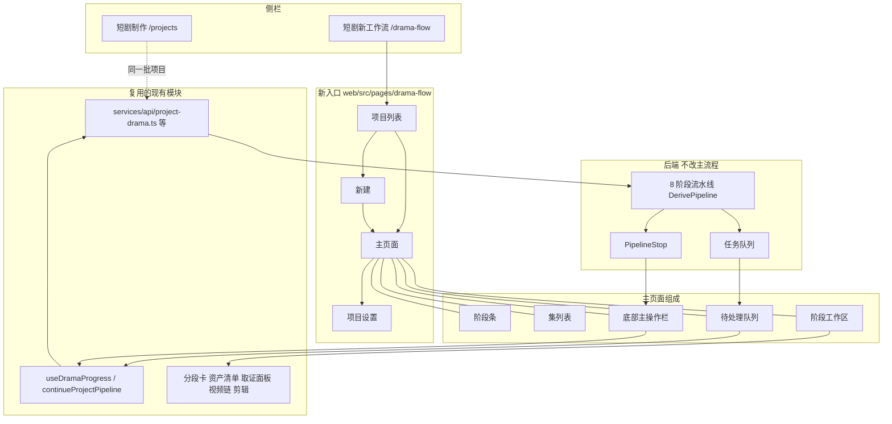

# 短剧新工作流：新入口方案与主页面交互

状态：方案待确认。上游文档：[short-drama-workflow-ux-redesign.md](short-drama-workflow-ux-redesign.md)（设计原则、问题清单、优化点 O1–O21、已确认的 5 个决定）。本文只写「以新入口落地」的部分，与上游冲突处以本文为准。

## 1. 需求复述

1. 网站新加一个入口，名字叫「短剧新工作流」，与现有「短剧制作」并存，不在原页面上改。
2. 新入口承载重新设计后的流程：一页做完一部短剧，默认只需点两次（提交建项、确认出视频），失败的地方就地重试。
3. 核心制作流程不变：后端 8 个阶段、三条流水线、生成模式、出视频前必须停，全部沿用。
4. 先给完整方案，再给主页面和页面交互。

与上游文档的一处变化：原决定 4「旧路由重定向到主线页」推迟。新入口验收通过前，旧页面原样保留，两边互不跳转；验收通过后再定是否让旧入口退场。

## 2. 入口与路由

### 2.1 导航

侧栏 `web/src/components/layout/workspace-sidebar-nav.tsx` 的 `buildNav` 里，在「短剧制作」下面加一项：

| 项 | 值 |
| --- | --- |
| 标题 | 短剧新工作流 |
| 路径 | `/drama-flow` |
| 显示条件 | `features.shortDramaEnabled && features.dramaFlowEnabled` |
| 选中判断 | `workspaceNavActiveId` 对 `/drama-flow` 开头的路径返回 `drama-flow` |

`dramaFlowEnabled` 是新加的功能开关，放在后台「功能可用性」页，默认关。这样可以先只给内部账号开，线上验收后再放开。

### 2.2 路由

| 路径 | 页面 | 说明 |
| --- | --- | --- |
| `/drama-flow` | 项目列表 | 与旧入口同一批项目，卡片上直接显示「现在卡在哪、下一步是什么」 |
| `/drama-flow/new` | 新建 | 3 个必填项，其余折叠 |
| `/drama-flow/:projectId` | 主页面 | 自动定位到当前停靠的阶段和集 |
| `/drama-flow/:projectId/:stage` | 主页面 | `stage` 为 `script / look / shots / video / cut`，可带 `?ep=<unitId>`、`?item=<待处理项 id>` |
| `/drama-flow/:projectId/settings` | 项目设置 | 模型、生成模式高级项、流水线只读显示 |

全部包在 `RequireAuth` + `RequireFeature feature="shortDramaEnabled"` + `RequireFeature feature="dramaFlowEnabled"` 里。

### 2.3 与旧入口的关系

- 数据同源：两个入口读写同一个项目、同一批接口，没有数据迁移。一个项目可以在旧工作台开，也可以在新工作流开。
- 新主页面右上角「更多」里放「在旧版工作台打开」，跳 `/projects/:projectId`。旧工作台不加反向链接，避免改动旧页面。
- 新入口不提供的能力（项目画布、黑白动作预演、技能配置）通过「更多」跳旧页面对应位置。

## 3. 页面清单

| 页面 | 负责什么 | 不负责什么 |
| --- | --- | --- |
| 项目列表 | 找到项目、看到每个项目的下一步、新建 | 批量操作 |
| 新建 | 收正文、画面类型、画幅，提交后直接开跑 | 逐项模型配置（放高级里） |
| 主页面 | 看进度、处理待办、推进主线、局部重试、出视频、成片 | 画布编辑、技能编辑 |
| 项目设置 | 模型、生成模式高级项 | 改流水线（建项后不可改） |

## 4. 架构



### 4.1 代码落点

```
web/src/pages/drama-flow/
  index.tsx              项目列表
  create.tsx             新建
  detail.tsx             主页面壳：阶段条 + 三栏 + 底栏
  settings.tsx
  model/
    stages.ts            5 个用户阶段与 8 个后端阶段的映射
    primary-action.ts    PipelineStop + 进度 → 底栏的一句话和主按钮（纯函数，可单测）
    inbox.ts             进度、任务、自检结果 → 待处理项（纯函数，可单测）
  parts/
    stage-strip.tsx
    episode-rail.tsx
    inbox-panel.tsx
    action-bar.tsx
    stage-script.tsx  stage-look.tsx  stage-shots.tsx  stage-video.tsx  stage-cut.tsx
```

`primary-action.ts` 和 `inbox.ts` 是这套交互的核心规则，写成纯函数，页面只负责渲染。

### 4.2 复用与新写

| 现有模块 | 处理方式 |
| --- | --- |
| `services/api/project-drama.ts`、`drama.ts`、`project-video-chains.ts` | 直接用，不改 |
| `useDramaProgress`、`continueProjectPipeline` | 直接用 |
| `DramaSegmentCard`、`DramaAssetChecklist`、`DramaTakeEvidencePanel`、`DramaTakeCompare` | 直接用；若样式与新布局冲突，加 props 而不是复制 |
| `VideoChainPanel`、剪辑器 `editor.tsx` | 嵌进视频、成片阶段工作区 |
| `OntologyDocumentsDrawer` | 分镜阶段的「导演文档」抽屉，直接用 |
| 各步骤的 `*Control`（`ScriptAdaptControl` 等） | 不复用界面，只复用它们调用的接口；新页面不再逐步摆按钮 |
| 旧的概览页、7 个页签外壳 | 不复用 |

需要从旧页面里抽出来共用的逻辑，移到 `web/src/pages/projects/workbench/` 下已有的共享文件或 `web/src/lib/`，旧页面改为引用，行为不变。

## 5. 阶段映射

| 用户看到的阶段 | 路由值 | 后端阶段 | 完成的标志 |
| --- | --- | --- | --- |
| 剧本 | `script` | script | 每集都有剧本 |
| 定妆 | `look` | style、palette、assets | 画风已锁，色卡齐，资产主图齐 |
| 分镜 | `shots` | shots、pack | 每集都有分段，自检没有硬失败 |
| 视频 | `video` | video | 每段都有选定的成片 |
| 成片 | `cut` | cut | 导出完成 |

阶段条上每个阶段的状态取其下后端阶段里最靠前的未完成状态：有 stopped 就是「等你处理」，有 running 就是「进行中」，全 done 才是「完成」。

## 6. 主页面

### 6.1 布局

```
┌────────────────────────────────────────────────────────────────────────┐
│ ← 项目名   9:16 · 写实 · 流水线一                      余额  ⋯更多      │ 顶栏
├────────────────────────────────────────────────────────────────────────┤
│  ✓剧本  ─  ✓定妆  ─  ●分镜 2/3  ─  ○视频  ─  ○成片                      │ 阶段条
├──────────┬──────────────────────────────────────────┬──────────────────┤
│ 第1集 ✓  │                                          │ 待处理 (3)       │
│ 第2集 !  │         当前阶段工作区                    │ 必须处理 1       │
│ 第3集 ●  │     （随阶段和所选集变化）                │ 等你确认 1       │
│          │                                          │ 建议 1           │
├──────────┴──────────────────────────────────────────┴──────────────────┤
│ 第 2 集有 1 段自检没过，修好后才能继续。            [ 去处理 ]          │ 底栏
└────────────────────────────────────────────────────────────────────────┘
```

| 区域 | 宽高 | 内容 |
| --- | --- | --- |
| 顶栏 | 高 48 | 返回列表、项目名（铅笔可改）、三项只读标签、余额、更多 |
| 阶段条 | 高 56 | 5 个阶段，可点击切换查看；不影响后台运行 |
| 集列表 | 宽 168，可收起 | 每集一行：序号、标题、本阶段状态点 |
| 工作区 | 自适应 | 当前阶段在所选集上的产物与编辑 |
| 待处理队列 | 宽 300，可收起；无待办时自动收起成一个计数按钮 | 三组待办 |
| 底栏 | 高 64，始终贴底 | 一句状态 + 一个主按钮 + 至多一个次按钮 |

宽度小于 1200 时待处理队列改为抽屉，小于 900 时集列表改为顶部下拉。

### 6.2 进入页面时定位到哪

1. URL 带 `stage` / `ep` / `item` 时按 URL。
2. 否则有「必须处理」的待办：定位到第一条所在的阶段和集。
3. 否则有停靠：定位到停靠阶段。
4. 否则定位到正在运行的阶段；全部完成则定位到成片。

### 6.3 底栏：一句话和一个主按钮

规则由 `primary-action.ts` 从 `PipelineStop` 和进度推出。任何时候只有一个主按钮。

| 情况 | 状态句 | 主按钮 | 次按钮 |
| --- | --- | --- | --- |
| 正在跑，无需处理 | 正在出第 2 集分镜，约还要 3 分钟。可以离开，做完会通知你。 | 无 | 暂停 |
| 正在跑，但有必须处理的待办 | 其他集还在跑。第 2 集有 1 段需要你处理。 | 去处理 | 无 |
| 停在必须处理的问题上（停靠不可继续） | 第 2 集有 1 段自检没过，修好后才能继续。 | 去处理 | 无 |
| 生成模式要求过目后停下 | 资产出完了，共 12 个。看过没问题就继续。 | 继续 | 无 |
| 停在出视频前 | 分镜都好了。出 3 集 14 段视频，预计 420–560 积分。 | 出视频 | 先试一段 |
| 余额不够 | 预计要 420 积分，当前余额 180。 | 去充值 | 只出第 1 集 |
| 视频出完，有失败段 | 14 段里 2 段失败。 | 重试失败的 2 段 | 无 |
| 视频齐了 | 视频都好了，可以剪了。 | 去剪辑 | 无 |
| 成片导出完成 | 成片已导出。 | 下载成片 | 下载交付包 |
| 已暂停 | 已暂停在第 2 集分镜。 | 继续 | 无 |

「去处理」做的事：打开待处理队列，选中第一条必须处理的项，工作区滚到对应位置并高亮。

### 6.4 阶段条

- 状态四种：完成（对勾）、进行中（转圈 + `已完成集数/总集数`）、等你处理（感叹号）、未开始（空心）。
- 点击任一阶段只切换工作区的查看内容。未开始的阶段点进去显示空态，说明它在哪一步之后开始。
- 当前正在跑或停靠的阶段下方有一条指示线，查看其他阶段时指示线不动，方便回来。
- 悬停显示后端子阶段明细，例如定妆：画风 ✓、色卡 6/6、资产 10/12。

### 6.5 集列表

- 每行显示本阶段在该集的状态。切阶段时状态点跟着变。
- 顶部固定一行「全部集」，用于定妆（项目级）和总览。剧本、定妆阶段默认选「全部集」，分镜、视频、成片默认选第一个未完成的集。
- 有必须处理待办的集排序不变，但行尾有红点和数量。

### 6.6 各阶段工作区

| 阶段 | 主要内容 | 就地能做的操作 |
| --- | --- | --- |
| 剧本 | 每集剧本正文，左侧是原文对应段落 | 直接改字；「重拆这一集」；台词缺失提示旁「补回」 |
| 定妆 | 上：画风卡（一张定调图 + 描述）。中：场次色卡条。下：资产墙，按角色 / 场景 / 道具分组 | 单个资产「重出」「换参考图」「改描述」；单场色卡「重出」；疑似重复的资产并排显示，「合并」或「都保留」 |
| 分镜 | 分段卡列表，每卡：序号、时长、画面描述、台词、引用的资产缩略图、自检结果。顶部显示本集合计时长与上限 | 单段「改」「按症状返修」「重出」；「重新装段」；「导演文档」抽屉 |
| 视频 | 分段网格，每格是视频或占位。点开一段看多条候选 | 单段「重出」「换模型重出」「选这条」；多选后「重出所选」 |
| 成片 | 剪辑器 + 导出 | 调顺序、换候选、转场；「导出」「下载交付包」 |

工作区里的编辑保存即生效，不弹确认。只有会覆盖已有结果的操作才提示，见 7.3。

### 6.7 待处理队列

三组，固定顺序：

| 组 | 含义 | 来源 | 是否挡住主线 |
| --- | --- | --- | --- |
| 必须处理 | 不处理就走不下去 | 任务失败、自检硬失败、不可继续的停靠 | 挡 |
| 等你确认 | 系统能继续，但按设置要你看一眼 | 生成模式停靠、疑似重复资产、出视频前 | 挡，点一下就过 |
| 建议 | 不处理也能出片 | 自检软提醒、台词缺失、时长偏差 | 不挡 |

每条待办的结构：

```
[!] 第 2 集 · 第 4 段 · 自检没过
    H1 人物位置前后不一致
    [按症状返修]  [重出这段]  [看详情]
```

- 标题写清在哪（集、段或资产名）和出了什么事，用人话，不出现任务 ID、`reason` 码。原始错误放在「看详情」里。
- 每条最多两个操作按钮加一个「看详情」。第一个按钮是推荐做法。
- 点整条：工作区切到对应阶段和集，滚到对应对象并高亮 2 秒。
- 处理完的项直接消失，组内计数更新。组为空时不显示组标题。
- 「建议」组可以整组「全部忽略」，忽略后不再提醒，除非对应内容重新生成。

## 7. 交互细则

### 7.1 局部重试

| 对象 | 入口 | 重试范围 | 是否影响别的 |
| --- | --- | --- | --- |
| 单集剧本 | 剧本工作区、待办 | 这一集 | 这一集的分镜会标为「剧本已变」，不自动重出 |
| 单场色卡 | 定妆工作区、待办 | 这一场 | 无（依赖后端 B2） |
| 单个资产主图 | 资产卡、待办 | 这一个资产 | 引用它的分段标为「资产已变」 |
| 单段分镜 | 分段卡、待办 | 这一段，保持整集合计时长不超上限 | 无 |
| 单集装段 | 分镜工作区 | 这一集（依赖后端 B2） | 该集已出的视频需确认是否保留 |
| 单段视频 | 视频格、待办 | 这一段，新结果作为新候选，不覆盖旧的 | 无 |

重试规则：

1. 第一次失败：待办显示「重试」。
2. 同一对象第二次失败：推荐按钮换成「换模型重试」，点开直接列出可用模型，选了就跑。
3. 同类失败达到 3 条：组顶部出现「全部重试（3）」。
4. 重试进行中：该项留在队列里，显示「重试中」，按钮禁用。
5. 重试成功后，如果它是唯一挡住主线的问题，主线自动继续（依赖后端 B3；没有 B3 时底栏显示「继续」）。

### 7.2 进度与离开

- 运行中的对象在原位显示进度：资产卡上转圈、分段卡骨架、视频格显示百分比。不弹全局进度框。
- 底栏状态句给出当前在做什么和大致剩余时间。
- 可以随时离开页面。回来时按 6.2 重新定位。阶段完成或出现必须处理的待办时，走站内通知。
- 数据刷新：进度用 `useDramaProgress` 轮询，文本任务用现有 SSE；页面不可见时降低轮询频率。

### 7.3 什么时候打断用户

只有三种情况弹确认：

| 情况 | 形式 | 内容 |
| --- | --- | --- |
| 要花钱出视频 | 底栏主按钮点击后，在底栏上方展开确认条（不是居中弹窗） | 段数、预计积分区间、余额、「确认出视频」 |
| 会覆盖已有结果 | 就地气泡确认 | 写明会丢什么，例如「第 2 集已出的 5 段视频会作废」 |
| 门没过却要强行继续 | 就地气泡确认 | 写明没过的是哪一项 |

其他操作一律直接执行，能撤销的给撤销：删除资产、忽略建议、合并重复资产，操作后在底部出现 5 秒的「已删除 · 撤销」。

### 7.4 出视频

1. 停在出视频前，底栏显示段数和预计积分（依赖后端 B4；没有 B4 时用现有 `estimateDrama` 的区间）。
2. 次按钮「先试一段」：默认选第 1 集第 1 段，可改选，只出这一段，出完在视频工作区显示，底栏变为「效果可以，出剩下的 13 段」。
3. 主按钮「出视频」：展开确认条，可勾选范围（全部 / 只出某几集），确认后开始。
4. 出片过程中每段独立显示状态，失败的段进入待办，不影响其他段。

### 7.5 空态、加载、出错

| 状态 | 表现 |
| --- | --- |
| 首次加载 | 阶段条和三栏骨架屏；底栏显示「正在读取进度」 |
| 阶段未开始 | 工作区居中一句话：「分镜会在定妆完成后自动开始。」不放按钮 |
| 进度接口失败 | 工作区保留上次内容，底栏变为「连不上服务，显示的可能不是最新进度。」+「重试」 |
| 写操作失败 | 就地显示失败原因，对象恢复到操作前的样子，不用本地缓存冒充成功 |
| 项目不存在或无权限 | 整页提示，返回列表 |

### 7.6 键盘与可访问性

- `J / K` 在待办间移动，`Enter` 执行该项的推荐操作，`[ / ]` 切上一集、下一集。
- 所有状态不只靠颜色：对勾、转圈、感叹号各有图标和文字。
- 底栏状态句用 `aria-live="polite"`。尊重 `prefers-reduced-motion`。

## 8. 项目列表与新建

### 8.1 列表

每张卡片：封面（画风定调图或首个资产）、项目名、`第几阶段 · 进度`、一句下一步（与主页面底栏同一句）、主按钮（与底栏同一个）。有必须处理待办的项目排在前面。空列表时只有一句话和「新建短剧」。

### 8.2 新建

必填 3 项：正文（粘贴或上传）、画面类型、画幅。

折叠在「更多设置」里，都有默认值：画风从哪来（默认导演定画风）、流水线（默认流水线一，提交后不可改，旁边写明）、每段时长、每集时长、生成几集、视频模型、生成模式开关「资产出完先让我看一眼」（默认关）、项目名（默认取正文标题）。

提交后直接进主页面并开始跑，不再经过概览页。底部显示预计花费区间，写明「出视频前不会扣视频费用」。

## 9. 状态与数据

| 数据 | 来源 | 存放 |
| --- | --- | --- |
| 进度、停靠 | `getDramaProgress` | React Query，键带用户 scope |
| 集、场、分段 | `getDramaEpisodes`、`getDramaScenes`、`listDramaSegments` | React Query |
| 待办 | 由进度、任务、自检结果在前端推出（`inbox.ts`） | 不单独存 |
| 已忽略的建议 | 小型偏好 | `localStorage`，键带用户和项目 |
| 当前阶段、集、选中待办 | URL | 不进 store |
| 队列和集列表的展开状态 | UI 偏好 | `localStorage` |

写路径全部走现有接口，失败向上抛出并就地显示，不做默认值兜底。

## 10. 后端配合项

沿用上游文档的 B1–B4，外加一个功能开关。

| 编号 | 内容 | 没有它时的降级 |
| --- | --- | --- |
| B0 | 功能开关 `dramaFlowEnabled`（功能可用性配置 + 前端 `features`） | 无，一期必须有 |
| B1 | `PipelineStop` 带结构化位置（集、段或资产 ID、失败项编码） | 前端从 `Reason` 文本和自检结果里匹配，匹配不到就只定位到阶段 |
| B2 | 单场色卡重出、单集重新装段 | 入口置灰并写明「暂只能整体重出」 |
| B3 | 局部重试清掉停靠后自动继续 | 底栏显示「继续」，多点一次 |
| B4 | 出视频前按范围估价 | 用 `estimateDrama` 的区间 |

## 11. 分期

| 期 | 范围 | 交付后能做到 |
| --- | --- | --- |
| 一（前端已实现，待验收） | B0；导航入口、路由、列表、新建页、主页面；阶段条、集列表、底栏、待办；五个阶段的就地编辑与局部重试：改剧本、单张定妆图重试、就地改分镜段、单段出片/重试/停止/挑片、成片嵌现有交付面板 | 全流程在新入口完成，不跳旧页面 |
| 二 | B1–B4 接入后去掉降级；快捷键；窄屏适配；决定旧入口去留 | 达到验收标准 |

开关默认关，只对内部账号开。

一期已知降级（都如实显示，不做兜底）：

- 没有「暂停整条流水线」的接口，只能停止出片。
- 列表卡片每个项目单独请求一次进度；卡片上的状态不含出片失败数和进行中数。
- 新建页把「画风从哪来」「怎么做」收进「更多设置」并用默认值。
- 余额不足、成片已导出两个状态前端推不出来，底栏不显示「去充值」「下载成片」。
- 改剧本不会自动重做后面的阶段；「去补参考」只定位到那一段。
- 「重试这一段」调用的是连续链重试接口，是否只重做失败的那一段，要以后端实际行为验收为准。

单文件预览稿放在仓库外的临时目录，用 mock 数据演示交互，不作为真实页面通过的证据。

## 12. 验收标准

1. 开关关闭时，侧栏和路由都看不到新入口；旧「短剧制作」行为无任何变化。
2. 同一个项目在新旧入口显示的进度一致。
3. 默认设置下，从提交建项到拿到成片，除处理失败外只需点两次：提交、确认出视频。
4. 任何时候底栏只有一个主按钮，状态句能回答「现在在干什么、要不要我管」。
5. 任一失败都能在待处理队列里找到，点一下能到出错的对象，并能只重试这一个。
6. 除花钱、覆盖结果、强行过门外，没有确认弹窗。
7. 出视频前一定停下并显示预计花费；不点确认不会产生视频任务。
8. 明暗主题、1200 以下宽度、键盘操作可用。

## 13. 不在范围

- 后端 8 阶段流程、三条流水线的内容、提示词与技能。
- 旧「短剧制作」页面的改动与下线。
- 项目画布、黑白动作预演（从「更多」跳旧页面）。
- 多人协作、审批流。

## 14. 已确认

1. 入口名「短剧新工作流」，放在「短剧制作」正下方。
2. 路径用 `/drama-flow`。
3. 不接受「编辑和重试先跳旧页面」，编辑和局部重试在新入口就地完成（见第 11 节）。
