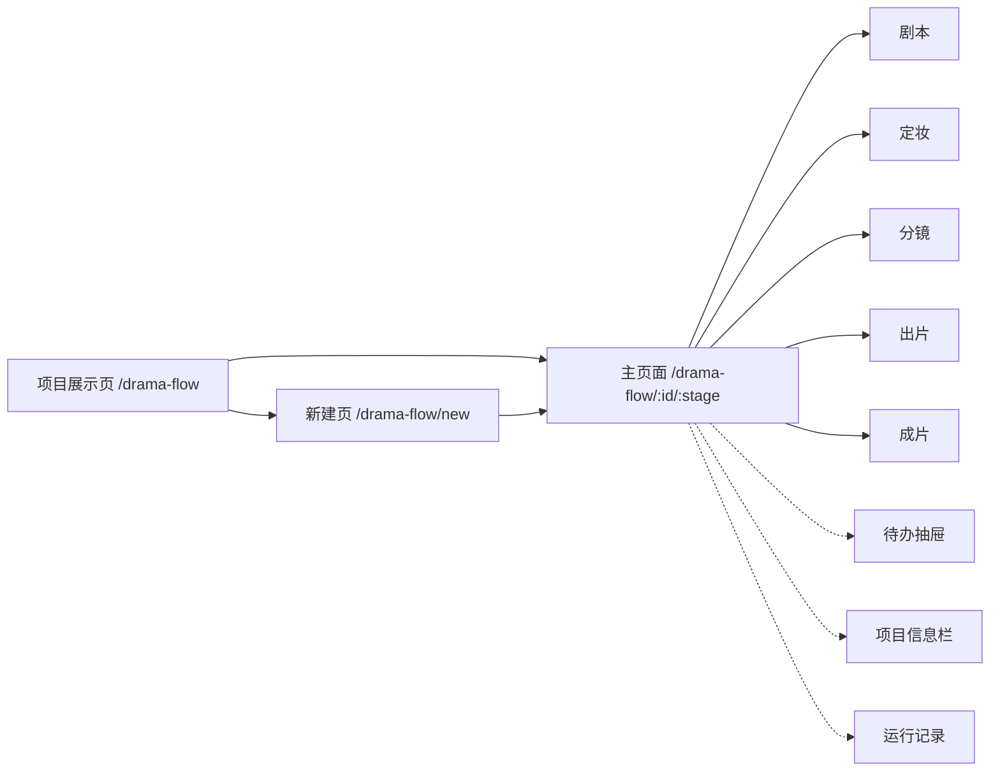
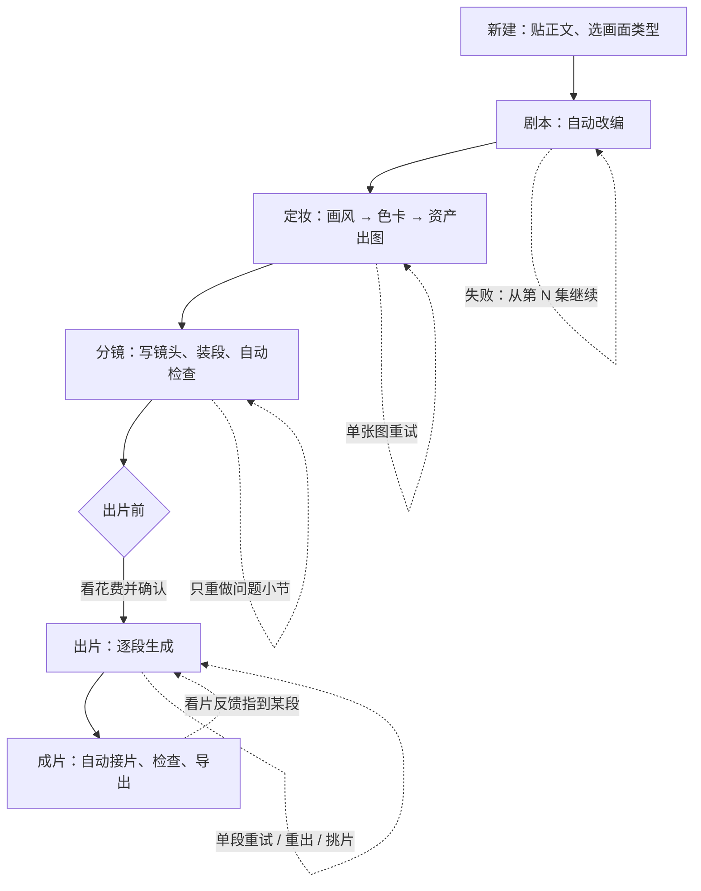

# 短剧新工作流：前端流程优化方案（第二版）

> 第一版见 `short-drama-new-workflow-entry.md`。第一版的入口、路由、五步流程、底栏、待办保留；第一版把各页内容压成了「状态加一句话」，这一点作废，由本文替换。

## 1. 需求复述

1. 流程没问题：一条主线五步（剧本、定妆、分镜、出片、成片），自动往下做，只在要花钱和出问题时叫人，失败的局部重试。这些不动。
2. 第一版的问题：为了「省心」把页面上的细节也删了。看不到风格锚、色卡、资产设定、镜头内容、提示词、参考图、失败原因、版本和花费，用户没法判断做得对不对，只能回旧页面看。
3. 这一版的目标：**删的是确认和跳转，不是信息**。每一页把这一步的产物完整摆出来，能在原地看清、原地改、原地重试。

一句话原则：少点按钮，不少看东西。

## 2. 第一版丢了什么

对照旧工作台和现在的「短剧制作」，逐步盘点如下。

| 步骤 | 旧页面有、第一版没显示的 |
| --- | --- |
| 列表 | 每步状态、段数与已出片数、失败数、待办数、生成模式 |
| 新建 | 章节识别结果、每集时长、单段时长、画风来源、生成模式、各步模型 |
| 剧本 | 每集梗概与场次、原文对照与出处高亮、台词保留检查、检查提醒、改编方式（改编 / 只调节奏）、流式输出、本步用的技能和模型、上次失败原因与续写 |
| 定妆 | 风格锚各项、风格封面、主基调色卡分组色带、场次色卡（按场）、资产的外观描述 / 原文依据 / 别名 / 出场场次 / 提示词 / 版本、角色子卡（服装、状态）、失败原因、上传替换、被哪些段引用 |
| 分镜 | 每个镜头的景别、机位、运镜、时长、画面、动作、台词、情绪弧；每段绑定的角色子卡、场景、道具、本场色卡；逐条检查问题；镜头表是草稿还是已装段；技能原文；重新生成问题小节、重新装段 |
| 出片 | 完整视频提示词与字数上限、实发参考图、首帧来源、视频模型 / 时长档 / 分辨率 / 画幅 / 是否出声、预估与实际花费、失败原因全文、请求记录、版本记录、候选证据（抽帧、人脸、台词字错率）、同场景连续生成、队列与已用积分 |
| 成片 | 每段切点与入片状态、缺口、成片过期提示、看片反馈、交付包、到画布精剪 |
| 全局 | 需求文档六项、生成模式、制作设置、每一步的运行记录 |

## 3. 设计原则

1. **产物全显示**。这一步做出了什么，就在这一步的页面上完整列出来，不折成一句话。
2. **三层信息，不藏第一层**。
   - 第一层（页面上直接看到）：产物本身、状态、数量、问题、失败原因、缩略图。
   - 第二层（点一下，在右侧详情栏里，不遮主区）：完整字段、提示词、参数、版本、花费。
   - 第三层（要看才展开）：模型原始输出、请求记录、技能原文。
3. **看不需要确认，改不需要跳走**。细节默认只读展示，旁边有铅笔；点了就地编辑，保存后自动重检。
4. **只留一个确认**：出视频前的花费确认。其余确认全部去掉或改成可撤销。
5. **失败留在原位**。失败的那张图、那一段、那一集上直接显示原因和「重试」，同时进待办。
6. **自动过程可见**。正在做的步骤显示做到哪、已出多少、用的什么技能和模型，可以展开看流式输出；不看也不影响往下走。
7. **不猜**。接口没给的数不显示成 0 或默认值，写明「没读到」。

## 4. 页面结构



主页面四个区，任何一步都一样：

```text
┌──────────────────────────────────────────────────────────────────┐
│ 项目名 · 画面类型 · 画风 · 生成模式      待办 3   运行记录   项目信息 │
│ ① 剧本 ✓   ② 定妆 ●(画风✓ 色卡✓ 资产 9/12)  ③ 分镜  ④ 出片  ⑤ 成片 │
├────────┬───────────────────────────────────────┬─────────────────┤
│ 集列表  │ 工作区：这一步的全部产物                 │ 详情栏（可收起）  │
│ 第1集   │  · 小节切换（如 画风 / 色卡 / 资产）      │  选中项的完整字段 │
│  12段   │  · 汇总行：数量、问题、花费              │  提示词、参数     │
│  出8 败1│  · 产物卡片 / 列表（默认显示细节）        │  版本、花费、记录  │
│ 第2集…  │                                       │                 │
├────────┴───────────────────────────────────────┴─────────────────┤
│ 正在出第 2 集定妆图 9/12 · 1 张失败             [ 处理 1 件事 ]      │
└──────────────────────────────────────────────────────────────────┘
```

- **阶段条**：五步，每步下面写小步骤和数字（定妆：画风、色卡、资产 9/12；出片：8/12，失败 1）。
- **集列表**：每集写段数、已出片数、失败数、待办数；支持搜索和矩阵视图（一屏看全剧进度）。
- **工作区**：这一步的产物，默认把细节摆出来。密度可切「完整 / 紧凑」，默认完整，记住用户选择。
- **详情栏**：选中一张图、一段、一个镜头时在右侧显示完整内容，不弹窗、不遮主区，可收起。窄屏时改成底部抽屉。
- **底栏**：一句状态话加一个主按钮，规则沿用第一版。

## 5. 各页显示什么

下面每一项都是「页面上要有」。标 ◆ 的是第二层（在详情栏），标 ◇ 的是第三层（展开看），其余在第一层。

### 5.1 项目展示页

每张卡片：

- 封面（风格封面，没有则第一张定妆图）、项目名、简介。
- 画面类型、画风、生成模式。
- 五步状态条：每步完成、进行中、等处理、没到。
- 集数；段数与已出片数（如 出片 18/36）；失败数；待办数。
- 现在卡在哪一句话（如「第 2 集第 5 段出片失败」）。
- 最近更新时间；已归档标记。
- 操作：继续、在旧版打开、归档、删除。

页面：搜索、按状态筛选（进行中、等我处理、已完成、已归档）、排序、新建。

### 5.2 新建页

一页填完，不分步；所有项都显示，带默认值，只有正文和画面类型必填。

- 正文：粘贴或导入文件。贴入后立即显示识别结果：几章、每章标题和字数、预计几集。
- 画面类型；画风来源（风格库选 / 导演按剧本定 / 传参考图分析），选风格库时显示风格卡片预览。
- 每集时长、单段时长、画幅。
- 生成模式：自动做到出视频前（默认）、全自动、每步停一下。每个选项写清会停在哪。
- 各步模型：文本、图片、视频，显示当前默认值，可改；没配好的直接标出并给去设置的链接。
- 输入是小说还是已成型的剧本（决定改编还是只调节奏）。
- 底部一句话预告：「将改编成约 N 集，自动做到出视频前，出视频前会先给你看花费」。

### 5.3 剧本

小节：剧集 | 原文对照 | 检查

- 汇总行：共几集、总字数、预计总时长、检查提醒几条、本步用的技能和文本模型。
- 每集一张卡：集号与标题、梗概、字数、预计时长、场次列表（场次头）、来源章节、检查提醒数、是否已有分镜。
- 选中一集：正文完整显示，按场分块；点铅笔就地改，保存后提示这一集已有分镜是否过期，并给「重做这一集分镜」。
- 原文对照：左剧本右原文，选中段落高亮原文出处。
- 检查：台词保留情况（共几句、几句没逐字保留，逐句列出并可定位）、台词写法不对的行。
- 进行中：显示正在写第几集，已写完的集先出现；◇ 展开看流式输出。
- 失败：显示失败原因、写到第几集，「从第 N 集继续」。
- 操作：重新改编所选集、只调节奏；会替换哪些集、连带哪些分镜和视频，在按钮旁直接写出，不另弹确认，提交后可在运行记录里取消。

### 5.4 定妆

小节：画风 | 色卡 | 角色 | 场景 | 道具 | 清单核对

画风：

- 风格封面、来源（风格库 / 导演分析 / 参考图分析）、是否已锁定。
- 风格锚逐项显示：画风与媒介、类型、时代、美术风格、镜头语言、光比与光线政策、调色倾向、禁用项。每项可就地改。
- 操作：重新分析、保存到我的风格、重新生成封面。◇ 分析的流式输出。

色卡：

- 主基调色卡：色卡图、版本号、来源；按主角组、配角组、道具组、环境组分行的色带，每个色块显示中文名、HEX、用途。
- 场次色卡：按集按场排列，每场一行色块、承接自哪一场、版本；没合成上的、场次已不存在的直接标出。
- 操作：重新合成（不调模型）、重新生成某一集的场次色卡。

角色、场景、道具（三个小节同一种卡片）：

- 卡片第一层：定妆图、名称、出图状态、失败原因、版本号、被几段引用、出场场次、外观描述前两行。
- 角色卡下直接列出子卡（服装、状态）：子卡图、变体名、用在哪几场、状态。
- ◆ 详情栏：完整外观描述、别名与称呼、原文依据、关联与状态变化、出图提示词、图片模型与规格、历史版本（可切回）、引用它的段列表（可跳到分镜）。
- 操作在卡片上：重试、重出、改设定后重出、上传替换、从素材库选、新增子卡、移出（被引用时不可移出并列出引用）。
- 小节头：共几个、已出几张、失败几张、排队几张；「全部重试失败的」。

清单核对：剧本里出现但资产库没有的角色、场景、道具逐条列出，可一键补提取。

### 5.5 分镜

- 汇总行（当前集）：几段、几个镜头、总时长、单段上限、检查问题几处、镜头表是草稿还是已装段、本步技能和模型。
- 每段一张卡，默认展开到镜头：
  - 段头：项目编号（如 E02S03）、标题、所在场次、时长与上限、镜头数、状态标记（有问题、超时长、没参考、已出片、出片后改过）。
  - 镜头行：镜号、景别、机位、运镜、时长、画面、动作、台词（说话人、说法、是否画外）、情绪弧。
  - 段尾：绑定的角色子卡、场景、道具、本场色卡缩略图；缺参考的标出。
  - 检查问题逐条写在对应镜头下面。
- 紧凑密度：每段只留段头、镜头首行和缩略图，一屏看更多段。
- ◆ 详情栏（选中镜头）：分镜卡全部字段可编辑（站位、灯光、台词原文等），保存后重检；◇ 这一节的技能原文。
- 操作：改镜头、拆段、并段、把首尾镜头移到相邻段、绑或换资产、只重新生成有问题的小节、重新装段、整集重新生成。
- 改动已有视频的段：直接在段头标「视频对应改动前的内容」，并进待办的建议项，不弹确认。
- 进行中：按场、小节显示已写出的镜头；失败显示原因和「从第 N 场继续」。

### 5.6 出片

- 汇总行（当前集）：几段、已出、生成中、排队、失败、还没出；本集预估花费、已用积分、余额；默认视频模型和规格。
- 每段一张卡：
  - 左：视频预览（选定的那条）；生成中显示状态；失败显示完整原因。
  - 中：段编号与标题、时长、镜头摘要；实发参考图缩略图（几张 / 上限）；首帧来源（开场段、上一段尾帧）；依赖状态（等上一段）。
  - 右：视频模型、时长档、分辨率、画幅、是否出声；预估花费，出过的显示实际花费；候选条数与是否已选定。
  - 按钮：出这一段、重试、停止、重出、看片与挑片。
- ◆ 详情栏（选中段）：
  - 完整视频提示词，显示字数和模型上限，可改，`@` 引用参考图；手改过的标「已手动改写」。
  - 参考图勾选与排序。
  - 版本记录：每条候选的时间、模型、规格、花费、证据（抽帧、人脸、台词字错率）、是否选定。
  - 候选并排对比、同步播放、选定。
  - ◇ 请求记录：任务号、提交与结束时间、用时、错误信息（可复制）。
- 批量：多选后一起出、一起重试；「同场景连续生成」显示范围、参考图数和整链预估后启动；「全部重试失败的」。
- 队列条：排队、生成中、失败、已完成、已用积分，点一行定位到那一段。
- 出片前的花费确认保留，确认框里列出：哪几段、模型与规格、每段预估、合计、余额。

### 5.7 成片

- 汇总行：共几段、已入片几段、缺几段、总时长；成片是否过期（内容改过、成片还是旧的）。
- 成片播放器；下面是时间线：每段一个缩略块，显示段编号、时长、切点、是否入片；缺的段留空位并可点去出片。
- 看片反馈：对着某一段写意见，记成一条待办，指到那一段。
- 导出：导出状态与进度、导出记录（时间、时长、是否过期）、下载成片、下载交付包、到画布精剪。

### 5.8 全局三件

- **待办抽屉**：必须处理、等你确认、建议三组，规则沿用第一版；每条写清是哪一集哪一段、原因是什么。
- **项目信息栏**：需求文档六项及确认状态、生成模式（可切）、每集时长、单段时长、画幅、各步模型、预算与已用积分。
- **运行记录**：每一步每一次运行一行：步骤、范围、技能、模型、开始与结束、用时、积分、结果；失败的显示原因；◇ 展开看输出；进行中的可取消。

## 6. 主流程



每一步的页面在自动进行时也是完整的：做出一部分显示一部分。用户可以全程不点任何东西走到「出片前」，也可以在任何一步停下来看细节、改细节。

## 7. 交互优化点

| # | 优化点 | 旧做法 | 新做法 |
| --- | --- | --- | --- |
| 1 | 入口 | 章节页、资产页、分镜制作、制作台来回切 | 一个页面五步，细节都在本页 |
| 2 | 步骤推进 | 每步点一次开始，中间多次确认 | 自动接续；页面只负责展示和修改 |
| 3 | 确认 | 替换、重跑、锁定风格等多处弹窗 | 只留花费确认；其余把影响写在按钮旁，提交后可取消 |
| 4 | 看细节 | 抽屉、弹窗盖住主区 | 第一层直接显示，第二层在右侧详情栏 |
| 5 | 编辑 | 进另一个页面或弹窗 | 就地改，保存后自动重检 |
| 6 | 失败 | 到任务中心找原因 | 原位显示原因和重试，同时进待办 |
| 7 | 重试范围 | 常常整步重跑 | 单张图、单个小节、单段视频、从第 N 集续写 |
| 8 | 改动的连带影响 | 弹窗确认后才知道 | 段头和集卡上直接标「已过期」，给一键重做 |
| 9 | 进度 | 需要守着侧栏 | 阶段条和集列表写数字；可展开看流式输出；离开不影响 |
| 10 | 花费 | 点了才知道 | 汇总行常驻预估、已用、余额；每段写预估和实际 |
| 11 | 挑片 | 进证据面板逐条看 | 段卡上写候选数，详情栏并排对比 |
| 12 | 全剧概览 | 逐集点开 | 集列表数字加矩阵视图 |
| 13 | 密度 | 固定 | 完整 / 紧凑可切，默认完整 |
| 14 | 键盘 | 无 | 上下切段、回车开详情、空格多选、Esc 收起 |

## 8. 实现方式

优先复用旧页面已有的展示件，不重画同样的信息；复用前先确认它们能脱离原页面单独使用。

| 新页面部位 | 计划复用 |
| --- | --- |
| 风格锚 | `drama-style-bible-editor` |
| 主基调色卡、场次色卡 | `project-palette-card`、`master-palette` |
| 资产卡、角色子卡 | `project-visual-asset-card`、`project-character-variants` |
| 镜头行、分镜卡 | `genre-shot-cards`、`shot-card-editor`、`DramaSegmentCard` |
| 流式输出与续写 | `drama-run-panel` 及各步 `*-stream` |
| 候选对比与证据 | `DramaTakeCompare` |
| 同场景连续生成 | `video-chain-panel` |
| 成片与交付 | `DramaDeliveryPanel` |
| 原文对照 | 现「短剧制作」的剧本视图 |

新写的部分：详情栏框架、各步汇总行、出片段卡、队列条、运行记录、矩阵视图、密度切换。

第一版已写的路由、开关、阶段模型、底栏、待办保留；五个阶段的工作区按本文重写。

## 9. 需要后端配合或先核对的

以下数据第一版没有拿到，第二版要显示，实现前逐项核对现有接口是否已给：

1. 列表卡片的聚合进度（每步状态、段数、已出、失败、待办）：现在要每个项目请求一次，需要一个批量接口，否则只对进入视野的卡片读取。
2. 每段视频的预估花费和实际花费、项目已用积分和余额。
3. 运行记录：每一步每次运行的技能、模型、用时、积分、失败原因。
4. 改剧本、改分镜之后哪些下游产物过期。
5. 成片导出状态和导出记录。
6. 「重试这一段」是否只重做失败的那一段。
7. 暂停整条流水线的接口。

核对结果是「没有」的项，页面上写「没读到」，不用默认值顶替，并记入待办文档。

## 10. 分期

| 期 | 内容 | 交付物 |
| --- | --- | --- |
| 一 | 主页面四区框架、详情栏、阶段条和集列表带数字；剧本、定妆两步按本文重做 | 能在新入口看全并改剧本、画风、色卡、资产 |
| 二 | 分镜、出片两步按本文重做；队列条；批量与连续生成 | 能看全并改每个镜头、每段提示词和参数，局部重试 |
| 三 | 成片、运行记录、项目信息栏、列表卡片与新建页补全 | 全流程细节齐全 |
| 四 | 后端配合项接入、键盘、窄屏、明暗主题验收 | 达到验收标准 |

每期交付前先更新单文件预览稿给你看，再写真实页面。

## 11. 验收标准

1. 第 2 节表里列出的每一项，在新入口对应的页面上都能找到，不需要回旧页面。
2. 从新建到「出片前」可以不点任何按钮走完；除花费确认外没有其他确认弹窗。
3. 任一张图、任一小节、任一段视频失败，都能在原位看到原因并只重试它自己。
4. 详情栏打开时主区仍然可见可操作。
5. 没读到的数据显示为「没读到」，不显示成 0。
6. 旧「短剧制作」入口不受影响，两边进度一致。
