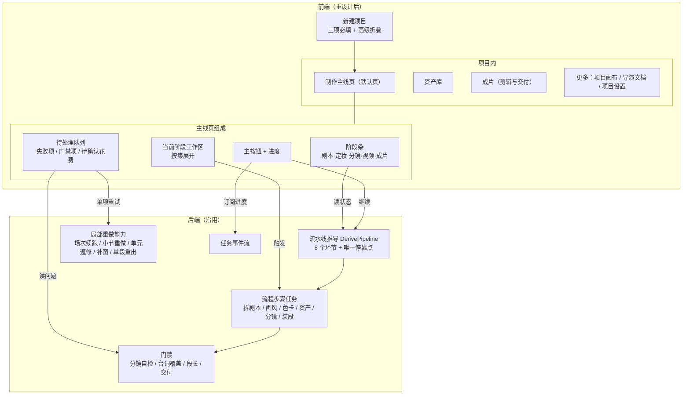
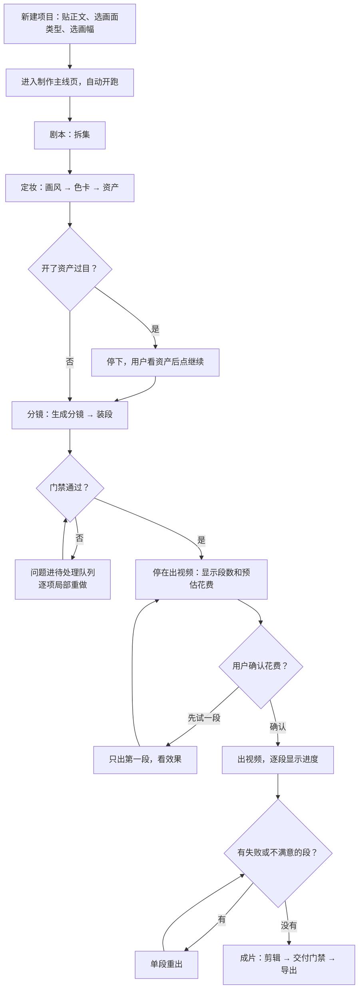
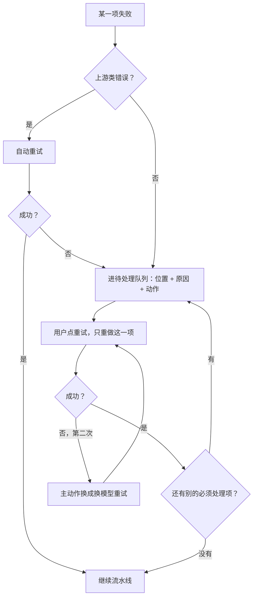

# 短剧工作流前端流程与交互重设计方案

状态：方案已确认，待排期实现。本文只定前端流程和交互，不含实现代码。
落地方式：以新入口「短剧新工作流」交付，旧「短剧制作」页面原样保留，见 [short-drama-new-workflow-entry.md](short-drama-new-workflow-entry.md)。入口、路由、分期和「旧路由重定向」的决定以该文为准。
依据：`backend/internal/drama/pipeline.go`、`run_mode.go`、`workflows.go`，`web/src/pages/projects/workbench/` 下的现有页面，以及 `docs/plans/workflow-ux-regression.md`、`full-chain-user-acceptance.md`、`project-workflow-optimizations.md` 和本体论流水线 T7 验收报告。
未细读的部分（资产页内部、制作台镜头编辑、剪辑器）在文中标「待核对」，落地前需要补读。

## 1. 需求复述

目标是让用户**清晰、便捷、省心**地做完一部短剧：

1. 交互清晰：任何时候都知道做到哪一步、现在该做什么、卡在哪里。
2. 删掉不必要的确认和操作：能自动接续的不让用户点，不影响结果的提示不弹窗。
3. 保证制作质量的前提下，保留核心制作流程：拆剧本 → 定画风 → 色卡 → 资产 → 分镜 → 装段 → 出视频 → 剪辑，这条依赖链和它的质量门禁不动。
4. 失败可以局部重试：哪一场、哪张图、哪一段坏了就只重做那一个，不整步重来。
5. 本次交付物：先理解现有工作流的设计意图和业务意图，再给出完整的前端流程与交互方案，含架构图、流程图和优化点列表。

## 2. 对现有工作流的理解

### 2.1 业务意图

| 意图 | 体现 |
| --- | --- |
| 把小说、剧本或一句创意变成可交付的短剧成片 | 八个固定环节，从拆剧本到剪辑 |
| 画面一致性靠前置依赖保证 | 画风 → 场次色卡 → 角色场景资产 → 分镜，后一步引用前一步的产物 |
| 钱花在视频上，花钱前必须由人确认 | 出视频在任何生成模式下都停，带预估花费 |
| 便宜的环节尽量自动跑 | 默认模式「跑到出视频前」，拆剧本到装段自动接续 |
| 质量问题在便宜的环节拦住 | 分镜自检、装段的台词覆盖和段长门禁、交付前质量门禁 |
| 长任务可恢复 | 按场次的检查点续跑、问题小节重做、本体论单元返修、资产图补图 |

### 2.2 设计意图

- 后端用一条派生的流水线状态驱动全局：`DerivePipeline` 给出每个环节的状态（已完成 / 进行中 / 停住 / 未开始）和唯一的停靠点（环节、原因、动作、能否「继续」）。
- 三条流水线（本体论导演、资产一体化、原流程）共用这八个环节，只是分镜和资产的做法不同。
- 三种生成模式只决定在哪些环节前停：跑到出视频前、资产我要过目、每步都问我。

后端这套模型本身是清楚的。问题主要在前端没有按它来组织页面。

### 2.3 现状问题

| 编号 | 问题 | 证据 |
| --- | --- | --- |
| Q1 | 一条主线分散在多个页签。项目内有 7 个页签，做完一部剧要在概览、剧情章节、角色与资产、分镜制作、剪辑成片之间来回切 | `detail.tsx` |
| Q2 | 两套阶段叫法并存。流水线是 8 个环节，「分镜制作」页又有自己的 6 个阶段（剧情、资产、分镜、预演、视频、交付），两边对不上 | `pipeline.go`、`workflow-shared.tsx` |
| Q3 | 概览页重复表达「现在该做什么」：流水线面板、当前任务区、快速入口、章节进度各说一遍 | `overview.tsx` |
| Q4 | 停靠点只给粗链接。需要人工处理的停靠大多只跳到章节页，不指到具体哪一集、哪一步、哪个按钮 | `project-pipeline-panel.tsx` |
| Q5 | 每一步的操作入口都在章节页的工具栏里（剧本优化、分析风格、场次色卡、资产提取、生成分段），用户要自己知道顺序 | `chapters.tsx` |
| Q6 | 提示和确认偏多。生成分段弹窗里有多条警告；资产页、章节页、制作面板里确认弹窗密集 | `chapters.tsx`、`assets.tsx`、`drama-panels.tsx` |
| Q7 | 生成模式有三档，建项时和概览里都能选；改了只影响之后，已停住的不补做，用户难以预期 | `drama-model.tsx`、`project-pipeline-panel.tsx` |
| Q8 | 重试入口分散：运行面板、导演文档抽屉、资产页补图、任务中心各有一套 | 多处 |
| Q9 | 长任务进度要打开侧栏或任务中心才看得到 | `chapter-storyboard-run-panel.tsx`、任务中心 |
| Q10 | 建项表单一次问十多项：内容、画面类型、画风来源、工作流、生成模式、视频模型、段长、画幅、每集时长、集数、项目名、摘要 | `create/project-composer.tsx` |
| Q11 | 历史验收里反复出现的体验问题：资产候选「待确认」挡流程、段长与渠道不匹配到生成时才报、非阻塞的创作提醒数量很大、装段后没有恢复入口 | 三份验收文档、T7 报告 |

## 3. 设计原则

1. **一条主线一个页面**。项目打开就是主线页，所有必经步骤在这里做完。
2. **一个主按钮**。页面上任何时刻只有一个主操作，文案就是下一步要做的事。
3. **默认自动，例外才打扰**。只在三类情况停下来：要花钱、会覆盖已有成果、质量门禁没过。
4. **问题就地解决**。停靠原因旁边直接放处理入口，不让用户去别的页找。
5. **重试到最小单元**。失败项列在一个队列里，每项自带重试按钮，只重做自己。
6. **前端重组，后端合同尽量不动**。八个环节、停靠推导和门禁沿用，前端只换组织方式。

## 4. 信息架构

### 4.1 架构图

### 4.2 页签调整

| 现在 | 调整后 | 说明 |
| --- | --- | --- |
| 制作概览 | 并入「制作」主线页 | 流水线面板升级为页面骨架，当前任务区和快速入口删除 |
| 剧情章节 | 并入「制作」的剧本阶段 | 章节编辑器保留，作为剧本阶段的工作区 |
| 分镜制作 | 并入「制作」的分镜、视频阶段 | 制作台保留，6 个内部阶段的导航去掉 |
| 角色与资产 | 「资产库」 | 定妆阶段只显示本剧要用的资产；完整管理留在资产库 |
| 剪辑成片 | 「成片」 | 剪辑和交付合在一起 |
| 项目画布、项目设置 | 收进「更多」 | 不在主线上 |
| 导演文档（仅流水线一） | 收进「更多」，同时在分镜阶段的问题项里可直达 | |

### 4.3 阶段合并（只改显示）

后端仍是 8 个环节，前端合成 5 个用户阶段。阶段条上每个阶段显示内部小步的完成数。

| 用户阶段 | 后端环节 | 用户要做的 |
| --- | --- | --- |
| 剧本 | 拆剧本 | 导入或粘贴正文，确认分集 |
| 定妆 | 导演定画风、场次色卡、角色场景资产 | 默认不用做；想看可以看、可以改 |
| 分镜 | 分镜、装段 | 处理没过门禁的项 |
| 视频 | 出视频 | 确认花费，挑选镜头 |
| 成片 | 剪辑 | 剪辑、过交付门禁、导出 |

## 5. 主线页交互

### 5.1 布局

- 顶部：阶段条。点某个阶段可以回看它的产物，不改变流水线进度。
- 中间：当前阶段工作区。多集时按集排成行，每行显示这一集在本阶段的状态。
- 右侧：待处理队列。没有待处理项时收起。
- 底部固定条：一句状态说明、主按钮、运行中的进度。

### 5.2 主按钮规则

| 流水线状态 | 状态说明 | 主按钮 |
| --- | --- | --- |
| 有任务在跑 | 「正在做第 2 集分镜，第 3/7 场」 | 无主按钮，显示进度和「停止」 |
| 自动模式下的可继续停靠 | 「上一步做完了」 | 「继续」 |
| 需要人工处理 | 「第 1 集有 2 个单元没过自检」 | 「去处理」，滚动到队列第一项 |
| 到出视频 | 「预计花费 X 积分，共 N 段」 | 「确认并出视频」 |
| 视频出齐 | 「可以剪辑了」 | 「去成片」 |
| 模型或渠道没配好 | 「还没配置文本模型」 | 「去配置」，配好后回到原处 |

### 5.3 进度呈现

- 运行中的任务直接在底部条和对应的集行里显示进度，粒度到场次或单元。
- 逐轮日志收进「查看详情」，默认不展开。
- 任务中心保留，但主线上不再要求用户去那里看。

## 6. 确认与打扰策略

| 类别 | 处理 | 例子 |
| --- | --- | --- |
| 保留确认 | 要花钱 | 出视频、批量重出视频 |
| 保留确认 | 会整体覆盖已有成果 | 本集已有 N 段时重新生成分段 |
| 保留确认 | 不可恢复的删除 | 删集、删项目、删资产且有引用 |
| 改为可撤销 | 可恢复的删除和替换 | 删单个镜头版本、移除资产绑定：直接执行，给「撤销」 |
| 改为事前校验 | 配置冲突 | 段长与视频渠道不匹配：建项和改设置时就拦，不等到生成 |
| 改为队列项 | 非阻塞提醒 | 创作提醒、待确认清单：进队列的「建议」分组，不弹窗，不挡流程 |
| 自动处理 | 前置步骤没做 | 没锁画风就点生成分段：自动先补前置步骤，不弹警告 |
| 自动处理 | 资产候选待确认 | 默认直接采用；只有疑似重名或冲突的进队列 |
| 删除 | 重复的引导 | 概览的当前任务区、快速入口 |

## 7. 生成模式简化

- 界面上只留一个开关：「资产出完先让我看一眼」，默认关。关对应 `until_video`，开对应 `review_from_assets`。
- 「每步都问我」收进项目设置的高级项，建项时不出现。
- 用户在某一步手动停止后，停在哪就是哪，不需要切模式。
- 后端三种模式不动。

## 8. 失败与局部重试

### 8.1 待处理队列

所有需要用户关注的项集中在一处，分三组：

| 分组 | 含义 | 是否挡流程 |
| --- | --- | --- |
| 必须处理 | 任务失败、门禁硬失败 | 是 |
| 等你确认 | 出视频花费、覆盖已有成果 | 是 |
| 建议 | 创作提醒、软失败 | 否，可一键全部忽略 |

每一项包含：位置（第几集、哪一场或哪一段）、一句话原因、一个主动作、可选的次动作。

### 8.2 重试粒度

| 失败对象 | 主动作 | 次动作 | 后端现状 |
| --- | --- | --- | --- |
| 某一集拆剧本或剧本优化失败 | 重试这一集 | 换文本模型重试 | 有按集任务 |
| 画风分析失败 | 重试 | 改用已保存的风格 | 有 |
| 某一场色卡失败 | 重试这一场 | — | 待核对是否支持单场 |
| 资产提取在某一场中断 | 从这一场接着跑 | 换文本模型接着跑 | 有检查点续跑 |
| 单张资产图失败 | 重出这一张 | 上传替换 | 有补图和自动重试 |
| 分镜在某一场或某个小节失败 | 重做这一节 | 换文本模型 | 有问题小节重做、检查点续跑 |
| 本体论单元没过自检 | 填症状返修这一个单元 | 打开导演文档 | 有单元返修 |
| 装段门禁没过（台词覆盖、段长） | 定位到这一段去改 | 重新装这一集 | 待核对是否支持单集重装 |
| 单段视频失败或不满意 | 重出这一段 | 改提示词后重出 | 有按段多版本 |

### 8.3 重试规则

1. 重试只重做这一项，已完成的不动。
2. 上游类错误（502、并发超限）先自动重试，次数用完才进队列。自动重试的次数和间隔沿用后端现有策略。
3. 同一项连续失败两次，主动作换成「换模型重试」。
4. 重试成功后，这一项从队列消失；如果它是唯一的停靠原因，自动模式下流水线自己接着跑，不用再点「继续」（需后端配合，见第 9 节 B3）。
5. 批量：同类失败超过 3 项时，分组头部给「全部重试」。

## 9. 流程图

### 9.1 主流程

### 9.2 失败处理

## 10. 新建项目

- 必填只留三项：要拍什么（正文或创意）、画面类型、画幅。
- 其余给默认值并折叠到「高级」：画风来源默认交给导演分析；工作流默认流水线一；视频模型用系统默认；段长用所选视频模型支持的默认值；每集时长和集数从正文估算后可改；项目名从正文自动起。
- 建项时就校验段长与视频渠道是否匹配。
- 提交前显示估算：大约几集、几段、视频预计花费区间。估算口径需后端提供（见 B4）。
- 建完直接进主线页并自动开跑，不再停在概览等用户点。

## 11. 优化点列表

优先级：P0 是这次重设计的骨架，P1 是明显省事的，P2 是锦上添花。

| 编号 | 优化点 | 解决 | 优先级 | 改动范围 |
| --- | --- | --- | --- | --- |
| O1 | 概览、章节、制作台合成一个制作主线页，作为项目默认页 | Q1、Q5 | P0 | 前端 |
| O2 | 阶段条合并成 5 个用户阶段，去掉制作台自己的 6 阶段导航 | Q2 | P0 | 前端 |
| O3 | 底部固定条：一句状态 + 一个主按钮 | Q3、Q5 | P0 | 前端 |
| O4 | 待处理队列，停靠原因带精确定位和处理动作 | Q4、Q8 | P0 | 前端；后端停靠信息需带上集和单元定位（B1） |
| O5 | 失败项就地局部重试，连续失败给换模型 | Q8 | P0 | 前端；个别粒度需后端补（B2） |
| O6 | 页签从 7 个减到 3 个加「更多」 | Q1 | P0 | 前端 |
| O7 | 删除概览的当前任务区和快速入口 | Q3 | P0 | 前端 |
| O8 | 生成模式改成一个开关 | Q7 | P1 | 前端 |
| O9 | 生成分段弹窗的多条警告改为自动补前置或事前校验 | Q6 | P1 | 前端 |
| O10 | 可恢复的删除改成直接执行加撤销 | Q6 | P1 | 前端；个别需后端软删除，待核对 |
| O11 | 非阻塞创作提醒进「建议」分组，可一键忽略 | Q11 | P1 | 前端 |
| O12 | 运行进度内嵌到集行和底部条 | Q9 | P1 | 前端 |
| O13 | 建项表单减到三项必填 | Q10 | P1 | 前端 |
| O14 | 段长与渠道匹配在建项和改设置时校验 | Q11 | P1 | 前端 |
| O15 | 局部重试解除停靠后自动接续 | Q8 | P1 | 后端（B3） |
| O16 | 资产候选默认采用，只把冲突的放进队列 | Q11 | P1 | 前端加后端 |
| O17 | 出视频前支持「先试一段」 | Q11 | P1 | 前端；后端按段出视频已有 |
| O18 | 建项时显示集数、段数和花费估算 | Q11 | P2 | 后端（B4） |
| O19 | 装段后无分段时给恢复动作 | Q11 | P2 | 后端 |
| O20 | 部署后提示刷新到新版本 | Q11 | P2 | 前端 |
| O21 | 导演文档版本历史 | T7 遗留 | P2 | 前后端 |

需要后端配合的项：

| 编号 | 内容 |
| --- | --- |
| B1 | 停靠信息增加结构化定位：集、场或单元、问题类型。现在只有文字原因 |
| B2 | 核对并补齐单场色卡重试、单集重装段 |
| B3 | 局部重做成功且停靠解除后，自动模式下自动接续 |
| B4 | 建项前的集数、段数、花费估算接口 |

## 12. 分期建议

| 期 | 内容 | 产出 |
| --- | --- | --- |
| 一 | O1、O2、O3、O6、O7：主线页骨架，复用现有章节编辑器和制作台组件 | 一个页面走完全流程 |
| 二 | O4、O5、B1、B2：待处理队列和局部重试 | 失败不用离开主线页 |
| 三 | O8 到 O17、B3：减确认、减表单、自动接续 | 默认路径上点击数明显下降 |
| 四 | O18 到 O21 | 估算、恢复和历史 |

## 13. 验收标准

1. 默认路径（两集、无失败）从建项到停在出视频，用户只需要：提交建项、确认出视频。中间零点击。
2. 整个默认路径不离开主线页。
3. 任何停靠状态下，页面上能读到原因，并且一次点击到达处理位置。
4. 文中第 8.2 节列出的每类失败，都能只重做失败项，已完成的项不重新生成、不重复扣费。
5. 默认路径上的确认弹窗只剩出视频花费确认。
6. 质量门禁（分镜自检、台词覆盖、段长、交付门禁）的判定结果与改版前一致。

## 14. 不在本次范围

- 八个环节的顺序、门禁规则和三条流水线的生成逻辑。
- 项目画布、风格中心、任务中心的内部设计。
- 剪辑器内部交互（只调整入口位置）。
- 多人协作和权限。

## 15. 已确认的决定

1. 资产候选默认直接采用（O16），只对疑似重名和冲突的保留确认。
2. 「每步都问我」从建项和主线页移走，只留在项目设置的高级项里。
3. 黑白动作预演不是必经步骤，作为分镜阶段里的可选工具。
4. 旧路由（`/projects/:id/chapters`、`/workflow/...`）重定向到主线页的对应阶段，不直接下线。
5. 分期按第 12 节的顺序执行。
